# Tapes ATK-60 — tipos

Para nombrar un cierre de canto se usa el **tipo** (1 a 7), el de las fotos. El formulario sigue guardando `TapeS1` … `TapeS13`. Esta ficha dice cuándo entra cada uno, según el espesor y si hay solape, y qué pinta hoy el visor Desing_2.

Las fotos de tipo salen de `Tapes soluciones.pdf`. Los dibujos pequeños son los PNG de ayuda del formulario (`Content/DesignTools/MenuIcon`).

El hormigón va en gris. El taco de madera, en naranja. El panel, en el rectángulo oscuro.

## Cómo se elige

Sin solape, el espesor decide el bloque. Con solape, el espesor no cambia el bloque: siempre es el tipo 1.

| Espesor | Solape | Bloque del formulario | Qué se ofrece |
|---------|--------|------------------------|---------------|
| Cualquiera | Sí | `DivTape_End_01` | Tipo 1. Solución 1 = TapeS1. Solución 2 = TapeS2 |
| Menor de 0,30 m | No | `DivTape_End_02` | Tipo 2. Solo TapeS3 |
| 0,30, 0,45, 0,60 o 0,90 m | No | `DivTape_End_03` | Tipo 4 (solución 1, TapeS4) o tipo 3 (solución 2, TapeS5). El 0,75 no entra aquí |
| Mayor de 0,30 y menor de 0,60, no exacto, múltiplo de 0,050 | No | `DivTape_End_04` | 0,35, 0,40, 0,50 y 0,55. Solución 1 = TapeS6 (dibujo tipo 3). Solución 2 = TapeS7 (tipo 5) |
| Mayor de 0,30 y menor de 0,60, no exacto, no múltiplo de 0,050 | No | `DivTape_End_05` | Solo TapeS8 (tipo 5). Ejemplo 0,44 m |
| Mayor de 0,60, no exacto, múltiplo de 0,050 | No | `DivTape_End_06` | 0,65, 0,70, 0,75, 0,80, 0,85… Solución 1 = TapeS9 (tipo 3). Solución 2 = TapeS10 (tipo 6). Solución 3 = TapeS11 (tipo 7) |
| Mayor de 0,60, no exacto, no múltiplo de 0,050 | No | `DivTape_End_07` | Ejemplo 0,67 y 0,69. Solución 1 = tipo 5. Solución 2 = tipo 7 |

Múltiplo de 0,050 quiere decir que el espesor en milímetros es múltiplo de 50. 0,65 m = 650 mm sí. 0,67 m = 670 mm no.

## Los siete tipos

### Tipo 1 — solape

Franja naranja en el canto. El encofrado sale del muro. Va **siempre que hay solape**, en el inicio, en el final o en los dos, sea cual sea el espesor.

| | Solución 1 | Solución 2 |
|--|------------|------------|
| Id | TapeS1 | TapeS2 |
| Dibujo | 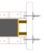 | 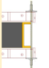 |
| Qué es | Fenólico naranja y tablones de madera | El mismo naranja; donde iban los tablones, fenólico |
| Visor | Pintado | Pintado. El tirante del canto solo va en esta solución |

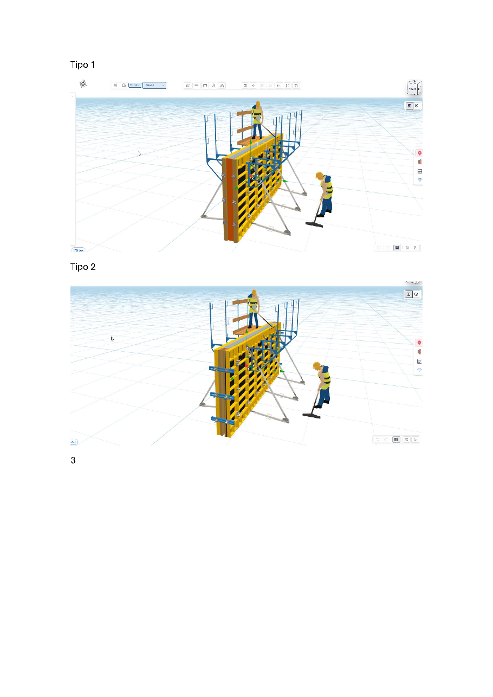

### Tipo 2 — menor de 0,30 m, sin solape

Muro estrecho. No lleva la franja naranja del solape. Solo hay una solución.

| Id | Dibujo | Qué es | Visor |
|----|--------|--------|-------|
| TapeS3 | 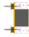 | Relleno entre dos tablones laterales y placa | Pintado |

La foto de arriba, la segunda, es este tipo.

### Tipo 3 — panel regulable

Panel de 0,75 con tirantes que salen del canto. El taco, si no cubre el espesor, queda hacia una cara.

| Cuándo | Id | Dibujo | Visor |
|--------|-----|--------|-------|
| 0,30, 0,45, 0,60 o 0,90, solución 2 | TapeS5 | 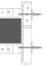 | Pintado |
| 0,35, 0,40, 0,50 o 0,55, solución 1 | TapeS6 |  | El dibujo es este. En el visor aún no es una solución propia |
| Mayor de 0,60, múltiplo de 0,050, solución 1 | TapeS9 |  | Pendiente de pintar |

### Tipo 4 — espesor exacto

El panel cierra todo el espesor. Angular en las dos caras. Sin taco.

| Cuándo | Id | Dibujo | Visor |
|--------|-----|--------|-------|
| 0,30, 0,45, 0,60 o 0,90, solución 1 | TapeS4 | 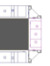 | Pintado |

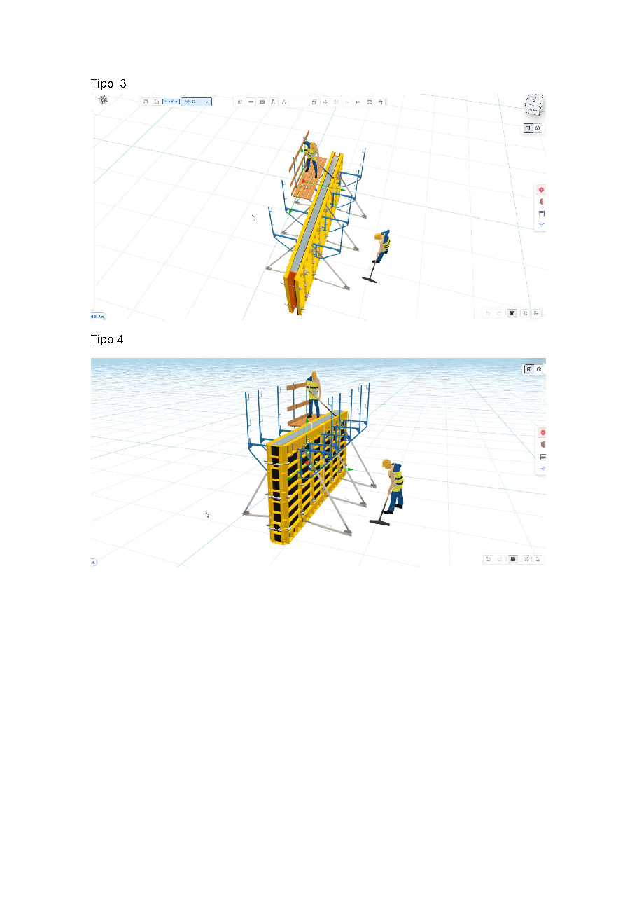

En las fotos, el tipo 3 es el muro visto a lo largo y el tipo 4 es el canto cerrado con paneles verticales, el del espesor exacto.

### Tipo 5 — panel y taco en el extremo

Angular en las dos caras, el panel que quepa y el taco naranja en un extremo. Sin gancho, sin placa y sin rigidizador. La grapa fija une el angular con el panel. La grapa variable cierra el taco.

| Cuándo | Id que guarda | Dibujo del formulario | En  | Visor |
|--------|---------------|------------------------|-----|-------|
| 0,35, 0,40, 0,50, 0,55, solución 2 | TapeS7 | 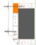 | El panel mayor que quepa y el resto taco. En 0,44 no entra: ese espesor no es múltiplo | Pintado |
| Mayor de 0,30 y menor de 0,60, no múltiplo. Ejemplo 0,44 | TapeS8 |  | En 0,44: panel de 0,30 y taco de 0,14. Solo hay solución 1 | Pintado |
| Mayor de 0,60, no múltiplo, solución 1. Ejemplo 0,67 | TapeS13 |  | En 0,67: panel de 0,60 y taco de 0,07 en el extremo | Pintado. Es el mismo cierre que TapeS7 |

El dibujo de la solución 1 de 0,67 es el del taco en el extremo. El id que se guarda es TapeS13, no TapeS12.

### Tipo 6 — taco en el extremo, muro ancho y múltiplo de 0,050

| Cuándo | Id | Dibujo | Visor |
|--------|-----|--------|-------|
| Mayor de 0,60, múltiplo de 0,050, solución 2. Ejemplo 0,65, 0,70, 0,80 | TapeS10 |  | Pendiente de pintar |

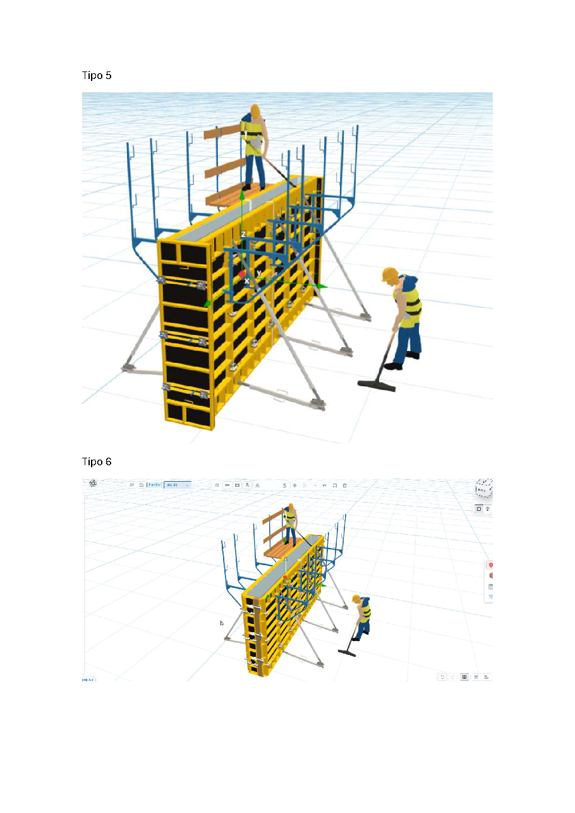

### Tipo 7 — taco en el medio

El taco no va en el extremo. Va entre paneles y lo cierra la grapa variable.

| Cuándo | Id que guarda | Dibujo | En | Visor |
|--------|---------------|--------|----|-------|
| Mayor de 0,60, no múltiplo, solución 2. Ejemplo 0,67 | TapeS12 |  | En 0,67: angular, panel de 0,30, taco de 0,07, panel de 0,30 y angular. Si el espesor pide más, entran paneles de 0,45, 0,60, 0,75 o 0,90 y el taco, de 10 a 300 mm, queda entre los dos lados | Pintado |
| Mayor de 0,60, múltiplo de 0,050, solución 3 | TapeS11 | 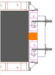 | Mismo dibujo: taco en el medio | Pendiente de pintar |

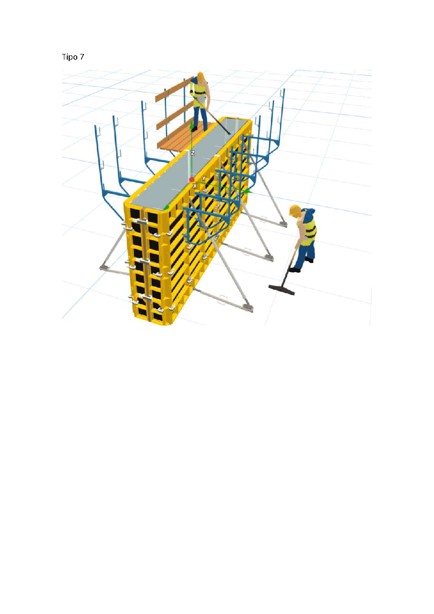

## Qué mirar al testear

Las notas naranjas de las ayudas. No están cerradas en el visor. Sirven para anotar el bug si al probar no se cumple.

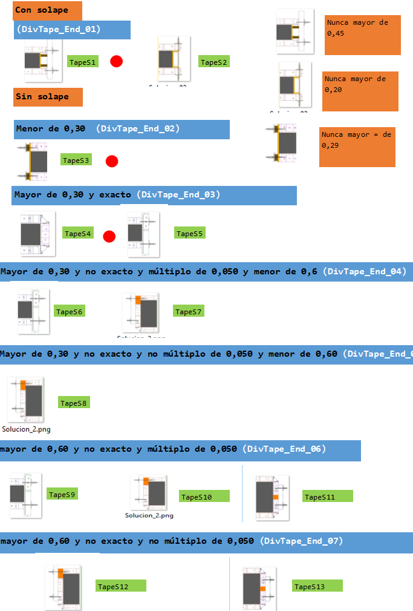

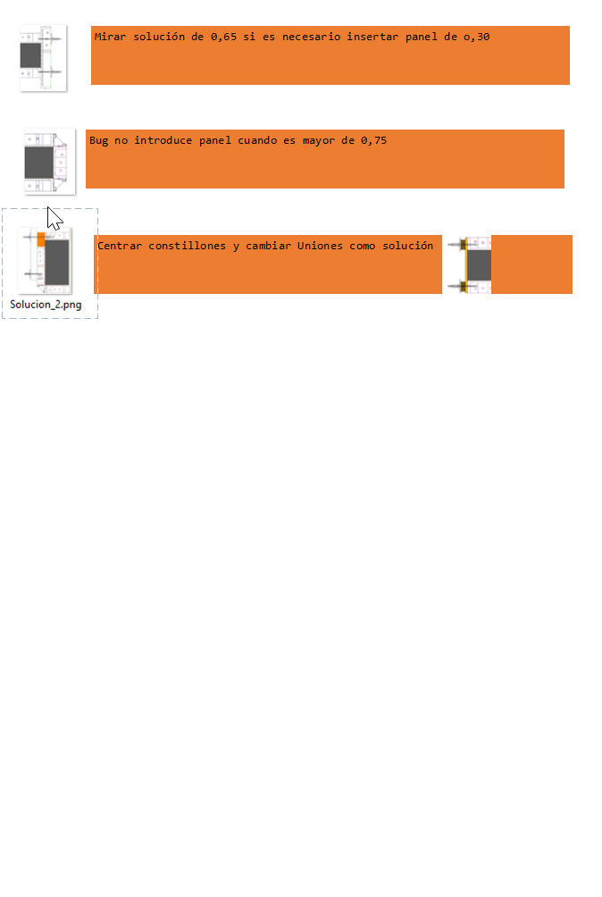

1. Con solape, el solape no debe pasar de **0,45 m**.
2. Sin solape, el remate de la longitud no debe pasar de **0,20 m**.
3. Con espesor menor de 0,30 m, el remate no debe quedar en **0,29 m**.
4. En **0,65 m**, mirar si la solución tiene que meter un panel de 0,30. Es el bloque del tipo 3, 6 y 7 (TapeS9, TapeS10, TapeS11). Esos tres aún no pintan.
5. Por encima de **0,75 m** no entra el panel que tocaría. Hay que comprobarlo en 0,80 y 0,85 (múltiplos) y en un no múltiplo, por ejemplo 0,82.
6. Centrar los constillones y cambiar las uniones para que queden como en la solución del dibujo.

El remate de madera de la longitud del muro sigue, salvo que haya solape en un extremo o en los dos. El taco del tipo 5 o del tipo 7 no lo quita.

## Para no liarnos con el nombre

- Al hablar: tipo 1 … tipo 7.
- Al mirar el formulario: solución 1, 2 o 3 de ese bloque.
- Al mirar el muro guardado: `TapeS1` … `TapeS13`. En el bloque de más de 0,60 no múltiplo, la solución 1 guarda TapeS13 y la solución 2 guarda TapeS12.
