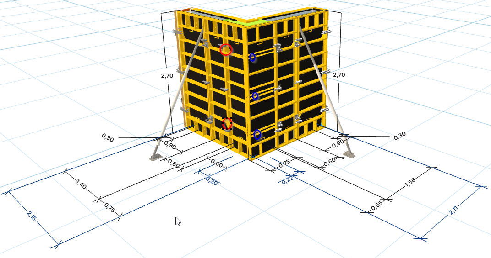
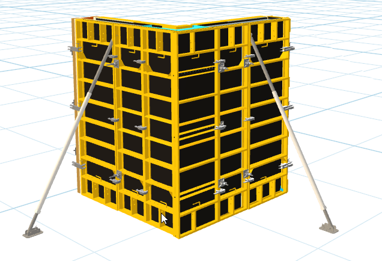
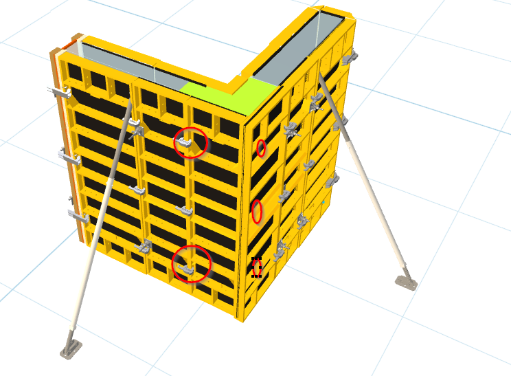
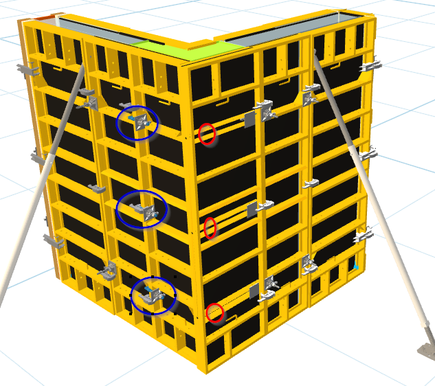
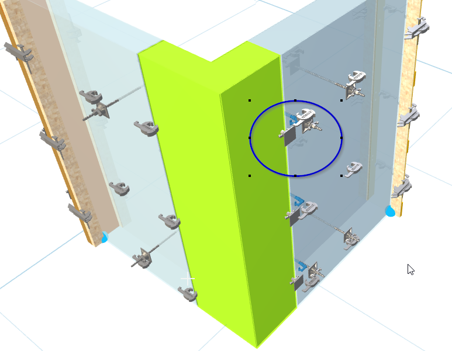
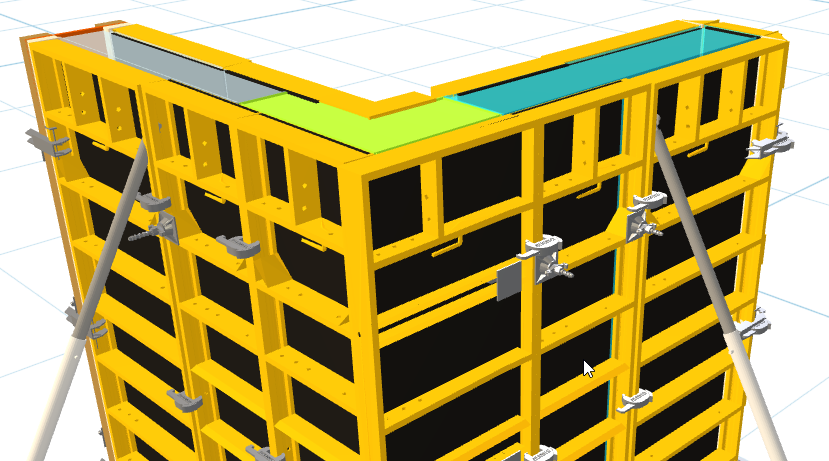

# Informe semanal — 5 de noviembre a 19 de noviembre de 2026

**Periodo:** 5 de noviembre – 19 de noviembre de 2026.  
**Fichero:** `Informe Semanal 05112026-19112026`.  
**Abierto el 5 de noviembre de 2026.**

## Convención de temas (vigente)

- Cada tema debe indicar tipo:
  - <strong>US</strong> para historia de usuario.
  - <strong>BUG</strong> para incidencia.
- Cada tema debe incluir:
  1. Estado.
  2. Detalle técnico.
  3. Imágenes adjuntas (cuando existan).
  4. Horas del detalle (las aporta Visual Studi Code con apoyo del agente).

## 1. Esta semana

### Solución con Esqunina con panel Regulable 0,75 — <strong>US</strong>

- **Estado:** abierto.
- **Detalle inicial:** se abre el frente para documentar e implementar la solución de esquina con panel regulable de 0,75, manteniendo comportamiento consistente con el diseño validado.
- **Imagen de referencia (bugs detectados):**

#### Incidencias del tema

1. Tirante interior junto al panel regulable desaparecido — <strong>BUG</strong>.
2. Unión entre panel regulable y panel a 90° para revisar con patrón de pilares/legacy — <strong>BUG</strong>.

#### Diagnóstico corregido y cambio aplicado (04 nov 2026)

- El volcado local del 04/11 a las 10:33 contenía los artículos `1920811` y `10443020` con `ElementType=Panel` y `UseStrictPose=true`, pero la captura de las 10:36 seguía sin mostrarlos. La presencia en el payload no prueba que la geometría quede visible.
- Ese payload colocaba gancho y placa en el mismo `LocalAlongMm` y altura, separados solo 12 mm en la normal; no reproducía las coordenadas y rotaciones locales de las cuatro esquinas de `PillarFormwork`.
- En la otra cara, `suppressCornerSeam` impedía ejecutar toda la rutina de unión. Por tanto, también se omitía el hardware de esa cara.
- Cambio actual: la esquina regulable reutiliza las posiciones y rotaciones de esquina de `PillarFormwork` en ambos muros del encuentro. En la cara donde se suprime la grapa se añade solo gancho y placa, sin llamar a la rutina del tirante.
- La lógica de `FormTie` no se modificó; la incidencia del tirante queda pendiente de un apartado separado.
- Referencias contrastadas: `PillarFormwork`, `CornerPanel270_75`, `CornerPanel90_75` y `ModuloTapeRightRegular75` del proyecto legacy.

#### Validación

- Compilación con MSBuild de Visual Studio: correcta, 0 errores.
- Prueba focalizada del helper: 3 casos de borde (inicio positivo, fin positivo y fin negativo), cada uno produce gancho y placa en las alturas 550, 1350 y 2150 mm, con coordenadas distintas según extremo y cara.
- Validación visual en el visor: pendiente de regenerar el mismo diseño con este último cambio. No se considera confirmada hasta ver la captura.

#### Seguimiento visual: herraje en cara equivocada (04 nov 2026, 11:11)

- La nueva captura confirma que el gancho y la placa quedaron en el panel perpendicular (círculos azules), en vez de la cara del panel regulable señalada en rojo.
- El payload de las 11:08 contiene herrajes en ambos muros (`IdWall` 1 y 4). La causa era el reemplazo de la unión suprimida: se activaba en cualquier esquina Universal y volvía a insertar herrajes en el muro no regulable.
- Cambio aplicado: se eliminó esa reinserción en la cara suprimida. Se mantiene la ruta normal de herrajes del panel regulable.
- No se modificó `FormTie` ni la generación del tirante; el segundo problema sigue fuera de alcance.
- Compilación de `Design.csproj` con MSBuild de Visual Studio 18: correcta, 0 errores y 0 advertencias.
- El payload de las 12:33 ya no contiene los herrajes especiales en `IdWall` 1; aparecen solo en `IdWall` 4. El usuario confirmó en la captura posterior que la cara ya es correcta.
- Pendiente: ajustar y validar la posición de gancho y placa en esa cara.

#### Orientación de la placa (04 nov 2026)

- A las 13:03, con los paneles ocultos, el usuario indicó que la placa requiere un giro de 180°; confirmó que la cara es correcta, pero la posición final de gancho y placa sigue pendiente.
- El primer intento cambió `RotX` y `RotZ`. Aunque se verificaron los valores generados, la captura de las 13:20 no mostró el giro visual esperado; no se considera resuelto.
- Se limitó el cambio a `RotZ` en la ruta de esquina, sin cambiar el patrón global de `PillarFormwork`. El usuario confirmó después que la placa ya se ve girada correctamente.
- La confirmación del giro no resuelve la posición de gancho/placa ni el tirante; esos resultados siguen separados.

#### Posición de gancho y placa: intentos y decisión (04–05 nov)

- El usuario confirmó que la cara correcta es la del panel regulable, pero indicó varias veces que las piezas seguían desplazadas. Pidió explícitamente no cambiar los demás ejes ni la rotación confirmada.
- Se probaron posiciones del patrón de `PillarFormwork` y coordenadas derivadas del legacy `TapeRP_E50_00`. El legacy expresa sus coordenadas en centímetros; copiarlas sin mapear origen, eje, cara y unidades no produjo una posición fiable.
- También se probó una traslación común para preservar la separación entre piezas. Una estimación de `33,91 mm` basada en los bounds de los STL no resolvió el contacto: la medición entre superficies transformadas seguía dando `44,23 mm`. Esa corrección se descartó; no reutilizarla.
- El usuario pidió detener los ajustes especulativos y dejar/restaurar la versión que funcionaba aunque estuviera desplazada, para corregir más adelante en AutoCAD. Esa restauración todavía debe comprobarse: el código actual de `LCornerFormwork.PlaceCornerHardwareFromPillarPattern` aún sobrescribe posiciones X/Z mediante `LegacyCornerHookAlongMm = 10` y `LegacyCornerHookFaceBaseMm = 300 + otherThicknessMm`.
- **Estado:** cara del herraje y giro de la placa confirmados por el usuario; posición final pendiente. No se afirma que gancho y placa estén acoplados ni se aplican más offsets por intuición.

#### Punto de referencia, intercambio y persistencia (05 nov)

- El punto quedó definido en la intersección superior de las caras exteriores de la L. Se retiraron los marcadores de los extremos y el usuario confirmó que el punto ya se ve.
- Se añadieron `cornerReferencePoints` al `.tnwall` de exportación/importación y a la persistencia SQL `dbo.TSql_Design_V2.AttCornerReferencePointsJson`. Los archivos antiguos sin la propiedad siguen siendo compatibles y reconstruyen los puntos desde los muros.
- La compilación de Desing para esta integración terminó con 0 errores y 0 advertencias; las comprobaciones geométricas de la esquina y el caso colineal también pasaron.
- La migración idempotente se aplicó y verificó en las dos instancias: desarrollo local `.\SQLEXPRESS` y producción `SQL5113.site4now.net`. Ambas tienen el catálogo `db_a197cd_desingproducction`, pero son servidores distintos.
- La importación autorizada en el diseño 30009 no se ejecutó: el visor local siguió mostrando Login. No se reemplazaron sus muros ni se validó allí el resultado.
- La guía de continuidad quedó ampliada en `Docs/Proyectos/Desing/ESQUINAS-REGULABLES-GUIA-IMPLEMENTACION.md`, con decisiones, intentos descartados, estado real y pasos para el siguiente agente.

#### Estado de cierre

- El frente continúa **abierto** para la posición final de gancho/placa y la validación del tirante interior/doble tirante con remate.
- No declarar resuelto el encofrado Angular del caso de 220 mm: se reportó falta de remate/tirante interior y solape de paneles; sigue pendiente una prueba visual específica.

#### Horas del detalle

| Reloj | Tramo | Suma |
|-------|-------|------|
| Visual Studi Code | Inicio y fin del tema no recuperables en el historial | No recuperable |
| Cursor/Copilot | Inicio y fin del tema no recuperables en el historial | No recuperable |

El historial contiene horas de capturas, no marcas de inicio y fin de dedicación para cada reloj. Por autorización del usuario, se cierra el registro de tiempo del tema como **no recuperable**, sin estimaciones.

### No salen los paneles en los pilares — <strong>BUG</strong>

- **Fecha y hora de apertura:** 04/11/2026, 16:09.
- **Estado:** cambio de render aplicado; pendiente validar visualmente en el visor.
- **Incidencia:** en algunos pilares ATK-60 no se veían los paneles. La captura de depuración contiene ocho paneles por pilar para los pilares 9–12, y el cliente entrega la lista completa al renderizador.
- **Cambio aplicado:** en pose estricta `Orientation="pillar"`, los paneles se desplazan 1 mm hacia fuera según su normal transformada, como medida frente a posible z-fighting. No se modificó el generador C#.
- **Verificación técnica:** análisis del JavaScript sin errores; comprobadas las cuatro orientaciones del patrón y `git diff --check` correcto.
- **Validación visual:** pendiente; no se considera resuelto hasta comprobar el resultado en el visor.

### Dibujo de muro 2D: espesor y modo de trabajo — <strong>BUG</strong>

- **Estado:** corregido en código, pendiente validación funcional completa en visor por el usuario.
- **Incidencia reportada:**
  1. Al conectar un muro en L/T desde un muro de 0,22, el flujo devolvía espesor 0,30 en puntos de refactor de unión.
  2. En una regresión intermedia, `wall2d` quedaba cerrado tras un único tramo.
  3. Con entorno en 0,35, el muro nuevo podía nacer en 0,30 por desalineación entre `offset default` y `ancho de muro X/Y`.
  4. Al pulsar `Dibujar muro` desde 3D/encofrado, no siempre forzaba modo línea.
- **Cambios aplicados:**
  - Se captura y prioriza el espesor del muro origen en el primer snap de conexión (extremo/cuerpo) para el commit del tramo nuevo.
  - Se preserva `numberOffsetMm` en rutas de split/refactor para evitar fallback al default global.
  - El auto-stop de `wall2d` ahora solo ocurre en cierre real contra el punto inicial del grupo.
  - Si X/Y seguían el offset anterior, al cambiar offset se sincronizan al nuevo valor.
  - El botón `Dibujar muro` pasa por la activación central que fuerza `lines` antes de iniciar la herramienta.
- Los botones directos de alternar (`Dibujar muro`, polilínea y `Acotar`) y la reanudación automática tras rehacer un tramo de muro 2D también fuerzan el modo `lines` antes de iniciar la herramienta (09/11/2026).
- **Documentación de continuidad actualizada:** `Docs/Proyectos/Desing/TRABAJOS-ACTIVOS-Desing2-2026-10-18.md` incluye reglas e invariantes para evitar repetir esta regresión.
- **Verificación técnica:** diagnóstico del archivo JavaScript sin errores tras los cambios.
- **Validación funcional pendiente del usuario:** crear muro base 0,22, conectar en L y T, confirmar que se mantiene 0,22; configurar 0,35 y confirmar que el tramo nuevo toma 0,35; activar `Dibujar muro` desde 3D/encofrado y verificar paso a `lines`.

### Remates por cara: suma y desactivación visual temporal — <strong>BUG</strong>

- **Estado:** en curso (frente abierto para iteración con ejemplos del usuario).
- **Reglas acordadas para la siguiente fase:**
  1. Diferenciar remates por cara: cada cara del muro puede tener tamaño distinto.
  2. Regla de suma: no mantener dos remates independientes en un muro, salvo cuando el caso de esquina por espesor lo exija.
  3. Los remates no van en tapes: siempre se resuelven entre paneles.
- **Cambio aplicado en esta iteración:** se desactiva temporalmente la inserción visual de tablón y grapas de remate para validar primero lógica y acotación.
- **Ajuste posterior (misma iteración):** los remates se vuelven a mantener en payload de encofrado para conservar la acotación; el visor oculta su render (tablón y grapa variable) en esta fase. Con ello se evita perder cotas y se corta el aviso repetitivo de espesor no detectado cuando no había elementos acotables.
- **Comportamiento esperado temporal:** se mantienen cálculo y acotación de remates, sin colocar piezas físicas de remate hasta cerrar criterios con los ejemplos paso a paso.
- **Documentación de continuidad actualizada:** `Docs/Proyectos/Desing/TRABAJOS-ACTIVOS-Desing2-2026-10-18.md`.

### Configurar tapes en extremos conectados a esquina — <strong>BUG</strong>

- **Estado:** corregido en código, pendiente validación visual del usuario.
- **Incidencia reportada:** al editar un muro ya conectado en esquina, el formulario permitía seleccionar tape en un extremo que no existe físicamente como extremo libre.
- **Cambio aplicado:** en el popup `Modificar muro > Configurar Tapes`, cada lado ahora evalúa su conexión (`_Idconnection_1` inicio, `_Idconnection_2` final). Si está conectado:
  - se desactiva el checkbox de solape de ese lado;
  - se bloquea la selección de soluciones;
  - las miniaturas se muestran al 50% de opacidad.
- **Objetivo funcional:** impedir configuraciones inválidas de tape en extremos no libres sin afectar el extremo opuesto cuando sí es editable.

### Remates ATK-60 en Desing_2 — <strong>US</strong>

- **Fecha y hora de apertura:** 09/11/2026, 10:49.
- **Estado:** abierto.
- **Detalle inicial:** se abre el frente para trabajar los remates de madera (`REMATE_WOOD`) del encofrado ATK-60 en Desing_2. Se estudió la documentación del visor Three.js y de los remates antes de tocar código.
- **Dónde vive la lógica:** el cálculo es C#. `PackAtk60LengthMm` y `GetWallsForCadSystems` (`Atk60WallsRepository.cs`) deciden el largo del remate; `EndFiller.cs` construye el tablón y las grapas regulables; `Atk60CornerFaceRemate.cs` reparte el remate por cara en las esquinas; `ExactWidthEndTape.cs` decide cuándo el solape lo sustituye. El visor Three.js (`master-article-details-stl-viewer.js`) solo pinta lo que recibe.
- **Reglas ya cerradas (no reabrir):** el tablón no pasa de 0,15 m a lo largo y tiene 0,12 m de ancho; si el largo es múltiplo de 0,15 lleva taco; el remate de esquina y el del tramo no se suman; TapeS1 y TapeS2 con solape sustituyen el remate de ese extremo, TapeS7 y TapeS8 no.
- **Fuera de alcance:** el remate de T o cruce con espesores distintos sigue pendiente y no se hace de paso.
- **Documentación de referencia:** `Docs/Proyectos/Desing/ATK60-Logica-Modulos-Wall.md`, `Desing/IA/docs/esquina-L-atk60.md`, `Desing/IA/docs/esquina-T-atk60.md`, `Desing/IA/docs/agente-tapes-atk60.md`, `Desing/IA/docs/tapes-tipos.md`.

#### Horas del detalle

| Reloj | Inicio | Entrega del agente | Fin |
|-------|--------|--------------------|-----|
| Persona | 09/11/2026, 10:49 | — | abierto |
| Devin | 09/11/2026, 10:49 | — | abierto |

- **Pausa (09/11/2026, 15:13):** se para para atender el BUG de configuración de «Dibujar muro». Se retoma cuando lleguen las imágenes y las soluciones de AutoCAD. En esta fase solo se localiza y se acota el remate; el tablón y las grapas se insertan después.

### Dibujar muro no recoge la configuración — <strong>BUG</strong>

- **Fecha y hora de apertura:** 09/11/2026, 15:13.
- **Estado:** cerrado — validado por el usuario el 09/11/2026 («ya funciona»).
- **Incidencia:** al dibujar un muro no se usan los valores del formulario de Configuración. Los valores solo se guardaban con «Guardar vista», y al recargar la vista guardada los devolvía a los de antes.
- **Cambio aplicado:** botón **Aceptar** arriba del panel Configuración (`ma-stl-config-accept`). Al pulsarlo se leen todos los campos (distancia entre puntales, offset, anchos de muro X e Y, recinto L, W, Ex1, Ex2, Ey1 y Ey2) y se guardan en la cookie `ma_stl_desing2_config`. Al abrir el visor y al restaurar una vista guardada se cargan estos valores, que mandan sobre los de la vista. Dibujar muro, offset e insertar recinto leen los valores del formulario. La distancia entre puntales se sigue guardando también en el diseño, en el servidor.
- **Textos:** claves nuevas `StlPreview_Desing2ConfigAccept*` en `_gen_masterarticles_resources.js`, en español e inglés. Se añadió al generador la clave `StlPreview_DimDevelopCornerReferencePoint`, que estaba en el `.resx` pero no en el generador.
- **Causa encontrada al leer el código:** el formulario no tenía un paso de confirmación y al restaurar la vista guardada los valores volvían a los de antes. Además, «Insertar recinto» no usaba Ex1, Ex2, Ey1 ni Ey2: los cuatro muros salían con la media de X e Y.
- **Corrección:** botón **Aceptar** arriba del panel Configuración guarda todos los campos en la cookie `ma_stl_desing2_config`; al abrir el visor y al restaurar una vista guardada se aplican y mandan sobre la vista. «Insertar recinto» pone a cada muro su espesor: izquierdo Ex1, derecho Ex2, inferior Ey1 y superior Ey2.
- **Espesor al conectar muros:** se mantiene la regla ya documentada en «Dibujo de muro 2D: espesor y modo de trabajo» (el tramo nuevo hereda el espesor del muro origen al conectar). Un muro que no conecta con ninguno usa la media de X e Y de la configuración.
- **Rediseño final del formulario (09/11/2026):** se eliminan los anchos X e Y y el croquis en L; quedan **Espesor** y **Altura**. Se elimina el botón «Actualizar default» y queda solo **Aceptar**, que guarda todas las variables de las dos pestañas (Entorno y Configuración) en la cookie `ma_stl_desing2_config` (versión 3). Los muros nuevos sin conexión toman el espesor y la altura del formulario; si conectan con un muro existente heredan solo el espesor de ese muro. El espesor y la altura también se guardan con «Guardar vista».
- **Documentación:** apartado Configuración de `Desing/IA/docs/desing-2-stl-viewer-funciones.md`.
- **Verificación técnica:** el JavaScript se analiza sin errores. Validación en el navegador hecha por el usuario el 09/11/2026.

#### Horas del detalle

| Reloj | Inicio | Entrega del agente | Fin |
|-------|--------|--------------------|-----|
| Persona | 09/11/2026, 15:13 | — | 09/11/2026, 17:08 |
| Devin | 09/11/2026, 15:13 | — | 09/11/2026, 17:08 |

### Empleado: la empresa (y otros atributos) no se guardan al crear/editar — <strong>BUG</strong>

- **Fecha y hora de apertura:** 10/11/2026, 09:14 (hora aproximada del reporte del usuario, tras cerrar la publicación del entorno develop).
- **Estado:** corregido y **validado por el usuario** el 10/11/2026 («ya funciona»); publicación develop en curso.
- **Incidencia reportada:** al crear o editar un usuario en `/Employee/Create_Employee`, la empresa no se guarda: al cambiar la empresa y volver a editar el usuario se ve el valor anterior. El usuario pidió arreglarlo, verificar que no falle otro atributo y documentarlo para que otro agente lo retome.
- **Causa raíz encontrada (10/11/2026, con capturas del usuario):** el **guardado sí funcionaba**; el fallo era de **carga**. En la lista «Juan Andrés Godoy Lopez» tiene empresa **TandemDesing**, pero al abrir «Editar empleado» el desplegable **Empresa** mostraba **ATENKO Uruguay** (la primera de la lista) en lugar de la asignada. El desplegable usaba `@Html.DropDownList("LinCompany", null, ...)`, que no aplica el valor del modelo como opción seleccionada y siempre deja la primera. Se cambió a `@Html.DropDownListFor(m => m.LinCompany, (SelectList)ViewBag.LinCompany, ...)` (mismo patrón que `TSql_Company/Create|Edit`), que sí preselecciona `employee.LinCompany`.
- **Análisis:** se revisaron `EmployeeController` (`Create_Employee` GET/POST, `Edit_Employee`, `SaveEmployee`), `EmployeeViewModel` y la vista `Create_Employee.cshtml`. Además del desplegable se corrigieron defectos relacionados que podían perder datos o duplicar:
  1. **`LinBusiness` se reseteaba a 1 en cada edición:** el GET no cargaba `LinBusiness` del empleado, así que el hidden del formulario siempre valía 1 y al guardar se sobrescribía. Ahora el GET carga `employee.LinBusiness`.
  2. **Alta/edición decidida por `ItComeFrom` y no por existencia del empleado:** si ya existía un empleado para el usuario, el flujo de alta podía duplicarlo y no actualizar el existente, o no hacer nada en silencio cuando `existing == null` en edición. Ahora se decide por `existing == null` (alta) frente a `existing != null` (edición), y `isEdit` incluye `existing != null`.
  3. **Vista sin hidden `AttPhotoMenu`:** se añade para que el POST conserve la ruta de foto.
- **Cambios aplicados en `develo`:**
  - `4b86a23` — `Desing/Controllers/EmployeeController.cs` (LinBusiness en GET + alta/edición por existencia) y `Desing/Views/Employee/Create_Employee.cshtml` (hidden AttPhotoMenu).
  - `fe11ece` — `Desing/Views/Employee/Create_Employee.cshtml`: `DropDownList` → `DropDownListFor` para el desplegable de empresa.
- **Verificación técnica:** diff revisado; los flujos estándar de alta y edición quedan idénticos (solo cambian los casos límite). No se pudo compilar .NET Framework en el agente (sin msbuild); la validación funcional es del usuario.
- **Validación pendiente del usuario:** crear/editar un usuario cambiando la empresa, guardar y volver a editar para confirmar que persiste **y** que al abrir la edición sale la empresa asignada (no la primera); repetir con nombre, apellidos, negocio, dispositivo y desarrollador CAD.
- **Nota para el siguiente agente:** el guardado de `LinCompany` ya era correcto; el fallo era solo visual del desplegable al editar. Si tras `git pull` + recompilar la edición sigue mostrando la primera empresa, revisar que la vista usa `DropDownListFor` y que `Model.LinCompany` llega con el valor del empleado (depurar el GET), y confirmar en la pestaña Network que el POST envía el `SysObjectID` de la empresa elegida.

- **Resolución final (10/11/2026, validado por el usuario):** la causa raíz real era que **MVC no emitía el atributo `selected`**  en el `<select>` de empresa aunque el modelo y el `SelectList` llevaban el valor correcto (se comprobó capturando el HTML renderizado: ninguna `<option>` salía con `selected`). Se alinearon los tipos (`long linCompany`) y, como garantía, se añadió en la vista un script que fija el desplegable al valor del empleado al cargar: `$('#LinCompany').val('@Model.LinCompany')`. Con eso la edición muestra la empresa asignada (TandemDesing) y el guardado persiste. Se eliminaron todas las líneas de diagnóstico temporales. **Estado: validado por el usuario.**

#### Horas del detalle

| Reloj | Inicio | Entrega del agente | Fin |
|-------|--------|--------------------|-----|
| Persona | 10/11/2026, 09:14 | — | abierto |
| Devin | 10/11/2026, 09:14 | 10/11/2026, 09:14 | 10/11/2026, 09:14 |

### Empresa: la plantilla (y el país) no se muestra asignada al editar — <strong>BUG</strong>

- **Fecha y hora de apertura:** 10/11/2026 (tras validar el BUG del empleado).
- **Estado:** corregido en código, **pendiente validación del usuario**.
- **Incidencia reportada:** mismo patrón que el empleado pero en la empresa (`/TSql_Company/Edit`): el desplegable de **Plantilla visual** no muestra la plantilla asignada al editar (sale la primera/por defecto), por lo que al guardar se machaca con el valor equivocado.
- **Causa raíz:** idéntica a la del empleado — el helper MVC (`DropDownListFor`) no marca `selected` de forma fiable en estos desplegables. El guardado (`company.LinPlantilla = model.LinPlantilla`) ya era correcto; el fallo era visual de carga.
- **Cambios aplicados (copia local, sin subir a `develo`):** en `Desing/Views/TSql_Company/Edit.cshtml` y `Create.cshtml` se añadió un script que fija los desplegables al valor del modelo al cargar: `$('#LinPlantilla').val('@Model.LinPlantilla')` y `$('#LinkCountry').val('@Model.LinkCountry')`. El desplegable de idioma (`LinkLanguage`) se renderiza a mano con `selected` y no fallaba.
- **Nota para el siguiente agente:** no subir a `develo` hasta validación del usuario. Si MVC vuelve a no marcar `selected`, la solución aplicada es el script de fijado.

### Publicación del entorno develop por FTP — <strong>US</strong>

- **Fecha:** 09–10/11/2026.
- **Estado:** cerrado (FTP configurado y funcionando).
- **Trabajo:** se configuró la publicación del sitio develop (Atenko / site6) por FTP con el usuario `ftpdevelop` creado el 09/11 (raíz `/Atenko`), ya que las credenciales FTP raíz no funcionaban. Se probó publicación incremental por MSDeploy (como TDESING_2027) pero el sitio site6 rechazó las credenciales (`ERROR_USER_UNAUTHORIZED`), por lo que se revirtió a FTP.
- **Decisión:** develop publica por FTP (sube el sitio completo en cada publicación); TDESING_2027 sigue por MSDeploy incremental.
- **Archivos:** `Desing/Properties/PublishProfiles/Atenko.net.pubxml` (FTP, usuario `ftpdevelop`), copia de seguridad `Atenko.net.pubxml.ftp.bak`.

### Plantilla: atributo «Color de Link» y estilos globales — <strong>US</strong>

- **Fecha:** 10–11/11/2026.
- **Estado:** cerrado — validado por el usuario.
- **Trabajo:** se añadió `AttLinkColor` a `dbo.TSql_Plantilla` (develop y producción), se cableó en EDMX/`TSql_Plantilla`, `PlantillaViewModel`, `PlantillaController`, formulario y recursos es/en. `_PlantillaStyles.cshtml` define `--tandem-link`, `--tandem-content-link` y `--tandem-brand-text`: enlaces de contenido subrayados con subrayado en color principal y texto en color de texto de marca (o primario si está vacío); botones, iconos, DataTables, paginación y dropdowns usan Color de Link; el menú lateral usa texto de marca en reposo y Color de Link en el item activo sobre fondo primario.
- **BUG relacionado:** al cambiar la empresa de un empleado no se recargaba la plantilla; se añadió `BaseController.InvalidateUserChromeCache` y `EmployeeController.RefreshUserChromeAfterCompanyChange` para invalidar la caché de chrome y refrescar la cookie si el empleado editado es el usuario actual.
- **Documentación:** `Desing/IA/docs/agente-ui-materio-datatables.md` (colores de plantilla).
- **Horas del detalle:** no recuperables en esta sesión; no se inventan.

### Desing_2 visor STL: chrome con colores fijos — <strong>BUG</strong>

- **Fecha:** 11/11/2026.
- **Estado:** cerrado — validado por el usuario («ya esta»).
- **Incidencia:** la barra superior del visor no mantenía el azul fijo y los iconos/textos quedaban blancos sobre botones claros; los botones del visor fuera de la barra salían blancos; al activar el fondo oscuro los menús de herramientas pasaban a gris/translúcidos en vez de blanco.
- **Cambios aplicados:** en `Desing/Views/Desing_2/Viewer.cshtml` la barra `#master-article-stl-viewer-toolbar.desing2-stl-actions-toolbar` queda fija en `#186cb7` con iconos/textos blancos; los `.btn` del visor fuera de la barra usan `#186cb7`. En `Desing/assets/materio/css/site.css` se añadieron reglas globales con `!important` y `color-scheme: light` para que `#desing2-article-stl`, `#plugin-blocks-tools`, `.plugin-blocks__tools`, toolbars y cabeceras del panel mantengan fondo blanco siempre, también en modo oscuro; los iconos de herramientas no activos usan `#186cb7`.
- **Verificación:** el toggle de fondo oscuro del visor solo cambia escena/materiales, no el chrome DOM; la regla CSS global cubre las barras translúcidas que mostraban el lienzo oscuro.
- **Documentación:** `Desing/IA/docs/desing-2-stl-viewer-funciones.md` (chrome del visor).
- **Horas del detalle:** no recuperables en esta sesión; no se inventan.

### Inicio: selector de oferta/cliente como DataTable con buscador — <strong>BUG</strong>

- **Fecha:** 11/11/2026.
- **Estado:** cerrado — ajuste aplicado, compilado y cierre solicitado por el usuario tras la iteración de altura/buscador.
- **Incidencia:** en el modal **Crear nuevo diseño** del inicio solo se veían las primeras ofertas y el selector de cliente era un desplegable sin buscador; además el popup quedaba demasiado alto.
- **Cambios aplicados:** `HomeController.DashboardOffersForDesign` y `DashboardClientsForDesign` devuelven ahora la fecha de creación (`created` para ordenar y `createdLabel` para mostrar/buscar). En `Views/Home/Index.cshtml` ambos selectores pasan a DataTables locales con `dom: 'ftp'`, `pageLength: 10`, `scrollY: '400px'`, `scrollCollapse: false`, `stateSave: false` y `colReorder: false`; la fila clicada rellena los hidden y marca la selección. Las tablas llevan `dt-no-single-scroll` y CSS con `.dataTables_scrollBody` a `400px !important` para que `datatables-state.js` no pise la altura; los modales usan `modal-lg` solo al elegir y tienen paddings/márgenes reducidos.
- **Verificación:** MSBuild Debug de `Design.csproj` correcto (solo warnings preexistentes de `Atk60`); validación visual iterada por el usuario durante el ajuste de altura.
- **Documentación:** `Desing/IA/docs/agente-ui-materio-datatables.md` (selectores de alta de diseño en Home).
- **Horas del detalle:** no recuperables en esta sesión; no se inventan.

## 2. Apartados realizados

1. Solución con Esqunina con panel Regulable 0,75.
2. No salen los paneles en los pilares.
3. Dibujo de muro 2D: espesor y modo de trabajo.
4. Remates por cara: suma y desactivación visual temporal.
5. Configurar tapes en extremos conectados a esquina.
6. Remates ATK-60 en Desing_2 (US, abierto, en pausa).
7. Dibujar muro no recoge la configuración (BUG, cerrado 09/11/2026).
8. Empleado: la empresa (y otros atributos) no se guardan al crear/editar (BUG, validado 10/11/2026).
9. Empresa: la plantilla (y el país) no se muestra asignada al editar (BUG, pendiente validación).
10. Publicación del entorno develop por FTP (US, cerrado).
11. Plantilla: atributo «Color de Link» y estilos globales (US, cerrado 11/11/2026).
12. Desing_2 visor STL: chrome con colores fijos (BUG, cerrado 11/11/2026).
13. Inicio: selector de oferta/cliente como DataTable con buscador (BUG, cerrado 11/11/2026).
