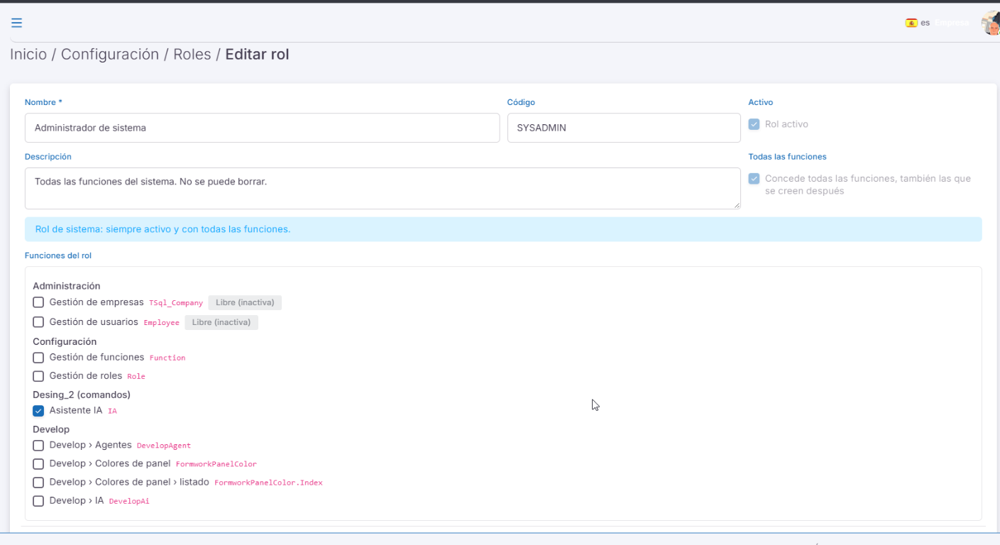
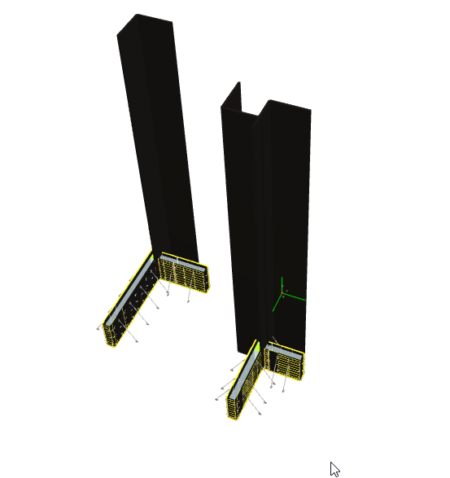
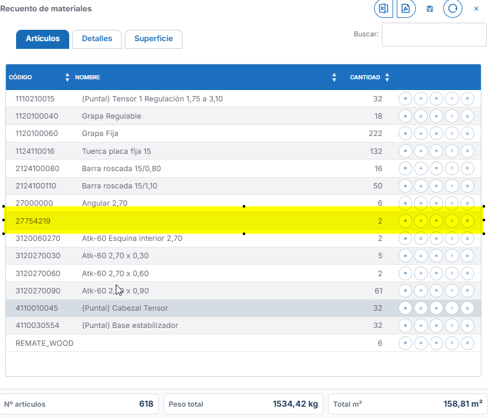
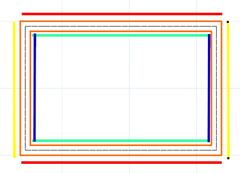
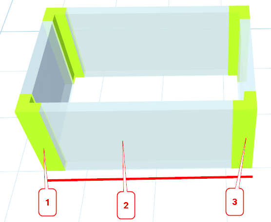
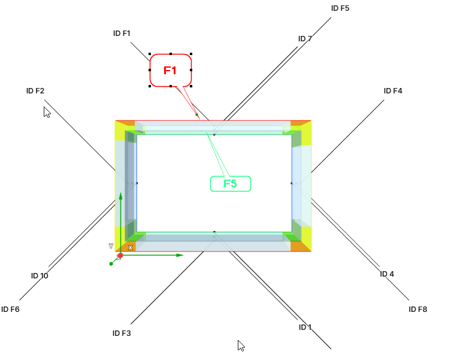

# Informe semanal — 16 de noviembre a 29 de noviembre de 2026

**Periodo:** 16 – 29 de noviembre de 2026.  
**Uso:** interno (Juan Andrés y quien fiscaliza).  
**Actualizado:** 20/11/2026 16:40 (Europe/Madrid; asignar funciones a roles). Abierto hasta el 29/11.  
**Esfuerzo:** reloj Copilot del tramo; no se suma con el de la persona.

**Iconos:** 🟦 <strong>US</strong> &nbsp; 🟥 <strong>BUG</strong>

---

# Parte 1. Apartados y subapartados

Solo titulares. En cada subapartado: categoría y esfuerzo total del tramo (si el esfuerzo es del padre, el hijo lleva «incluido»).

## 0. Semana anterior (5–15 nov)

| Apartado | Tipo | Estado |
|----------|------|--------|
| Esquina panel regulable 0,75 | 🟦 US | Abierto |
| Tirante / unión 90° | 🟥 BUG | Parcial |
| Paneles en pilares / curvo ATK-60 | 🟥 BUG | Validación pendiente |
| Dibujo 2D espesor | 🟥 BUG | Código OK |
| Remates por cara | 🟥 BUG | En curso |
| Intranet empleado/empresa | 🟥 BUG | Parcial |
| FTP, plantilla, visor, recortar, offset, DWG, login, esquina, unión T | 🟦/🟥 | Cerrado 09–12/11 |

## 1. Seguridad

| Subapartado | Tipo | Esfuerzo | Estado |
|-------------|------|----------|--------|
| Roles y funciones (menú, servidor, JS) | 🟦 US | 2,0 h | Entregado a probar |
| Listas, modal crear, asignar roles por empleado | 🟦 US | incluido | Entregado |
| Proteger IA con función | 🟦 US | incluido | Entregado |
| Asignar funciones al rol (dos tablas, arrastrar) | 🟦 US | 20/11 16:28–16:40 | Entregado a probar |

## 2. Develop › IA

| Subapartado | Tipo | Esfuerzo | Estado |
|-------------|------|----------|--------|
| Catálogo IA, comandos y frases | 🟦 US | 1,8 h | Entregado a probar |
| Sync derechos/defaults a producción | 🟦 US | 0,1 h | Hecho |

## 3. Oferta cliente

| Subapartado | Tipo | Esfuerzo | Estado |
|-------------|------|----------|--------|
| Oferta desde diseño (plantilla, PDF, popup) | 🟦 US | tramo 18/11 12:50 → 19/11 15:16 | En curso |
| Constructor visual de plantilla | 🟦 US | incluido | Entregado |
| Contactos de cliente | 🟦 US | incluido | Entregado |
| Overlay tapa plantillas | 🟥 BUG | 19/11 | Corregido |
| Razor CS0103 en plantillas | 🟥 BUG | 19/11 | Corregido |
| Popup Create / popup=true | 🟥 BUG | 19/11 | Corregido |
| Contactos jQuery | 🟥 BUG | 19/11 | Corregido |
| DataTables dashboard | 🟥 BUG | 19/11 | Corregido |
| Generar oferta forzaba wall3d | 🟥 BUG | 19/11 | Corregido |

## 4. Encofrado colores ATK-60

| Subapartado | Tipo | Esfuerzo | Estado |
|-------------|------|----------|--------|
| Modo colores (solo paneles verticales) | 🟦 US | tramo 18/11 16:07 → 19/11 09:19 | Usable |
| Paleta por ancho (develop y producción) | 🟦 US | 19/11 ~09:19 | Hecho |
| Colores no pintaban / hay que reencofrar | 🟥 BUG | 18/11 | Corregido |
| Color plano pisaba fenólico | 🟥 BUG | 18/11 | Corregido |
| Cotas y volver de Colores a Encofrar | 🟥 BUG | 18–19/11 | Corregido |

## 5. Recuento de material

| Subapartado | Tipo | Esfuerzo | Estado |
|-------------|------|----------|--------|
| Esquina interior: no duplicar piel | 🟦 US | 19/11 ~20:32 + 20/11 mañana | Validado |
| Universales 0,75: código y nombre de maestro | 🟦 US | 20/11 ~11:35 | Entregado |
| Piel fenólica reescalada (torres negras) | 🟥 BUG | 20/11 ~10:33 | Corregido |
| Colores → Encofrado no repintaba Mesh | 🟥 BUG | 20/11 ~10:33 | Corregido |

## 6. Maestro de artículos

| Subapartado | Tipo | Esfuerzo | Estado |
|-------------|------|----------|--------|
| Visor STL en Editar (sin uploads 3D) | 🟦 US | 1,5 h | Entregado a probar |
| Colores 1/2 y color de sistema en paneles | 🟦 US | incluido | Entregado |
| Details igualado a Editar | 🟦 US | incluido | Entregado |

## 7. Creación de Caras y Acotación

| Subapartado | Tipo | Esfuerzo | Estado |
|-------------|------|----------|--------|
| Elemento cara interior/exterior al crear el muro | 🟦 US | 20/11 ~13:03 → overlay | Cerrado |
| 8 caras en recinto (horario, colores) | 🟦 US | incluido | Cerrado |
| Develop Cotas: Caras + ID Faces (`F-n`) | 🟦 US | incluido | Cerrado |

## 8. Refactorización de cotas

| Subapartado | Tipo | Esfuerzo | Estado |
|-------------|------|----------|--------|
| Caras sólidas; ocultar muros al activar Caras | 🟦 US | 20/11 ~13:50 → 14:17 | Cerrado |
| Leyenda `W-n` / `F-n` (sin «ID»); interiores por dentro | 🟦 US | incluido | Cerrado |
| Longitud de cara; muros a ejes; V-ext magenta | 🟦 US | incluido | Cerrado |

---

# Parte 2. Detalle (qué se hizo y qué se solucionó)

Imágenes: solo las que el agente **recibió** en VS Code (`vscode-chat-images`). 16–19/11: no hay adjuntos ahí. 20/11: seis.

## 1. Seguridad

Antes, cualquier usuario autenticado veía todo. Ahora el modelo es usuario → roles → funciones (`TSql_Roles_V2`, `TSql_Functions`, `TSql_RoleFunction`, `TSql_UserRole`). Si un comando no tiene función activa, es libre. El Administrador de sistema tiene todas. Se aplica en servidor (403 / Acceso denegado), menú Materio y comandos JS de Desing_2. Pantallas en Configuración › Roles y funciones. En Empleados se arrastran roles. La función «IA» oculta botón/pestañas y rechaza endpoints.

### Asignar funciones al rol (20/11 16:28–16:40)

El Editar rol listaba funciones con checkboxes (pantallazo de SYSADMIN). Pedido: igual que **Empleados › Asignar roles**: izquierda asignadas, derecha disponibles, arrastrar o flechas, guardado al momento.

**Qué se hizo:** `SecurityRepository.AddRoleFunction` / `RemoveRoleFunction` (borrado lógico, invalida caché). Pantalla `Role/AssignFunctions` + JSON add/remove. Botón en el listado de roles, ficha y Editar. Se quitaron los checkboxes del formulario: guardar el rol ya no sincroniza (ni borra) funciones. SYSADMIN bloqueado. Si al quitar una función el usuario actual pierde `Role`, se revierte. Textos es/en. Compilación Design 0 errores.

**Qué se solucionó:** asignar funciones deja de ser un formulario largo; no se pierden al editar nombre/código. Sin cambio de esquema.

**Imágenes recibidas (20/11 ~16:28):**

## 2. Develop › IA

Develop › IA: DataTable de funciones, órdenes y significado, con idioma. Los comandos «Pendiente de IA» se cablean a handlers de barra ya existentes. Frases de `frases-no-comprendidas.json`: el programador las deja para todos; el usuario solo para él. Sync a producción: inserts aditivos, sin copiar negocio.

**Imágenes:** ninguna.

## 3. Oferta cliente

Al hacer oferta se elige plantilla. Del cliente: dirección (email más adelante). Layout `TextLayoutJson` (LOGOS / ADDRESSES / TEXTS / COMPLEMENTS). Constructor A4: paleta a la derecha, resultado a la izquierda; alto de recuento dinámico. Popup desde el visor: no cambia el modo; overlay solo mientras carga; arrastrable; lista de plantillas de la empresa. Se corrigieron overlay, Razor CS0103, popup, jQuery, DataTables y el salto a `wall3d`. Pendiente: índice de recuentos y correo.

**Imágenes:** el chat citó bocetos; no se conservaron en `vscode-chat-images`.

## 4. Encofrado colores ATK-60

Geometría y color en Desing; el visor pinta. Solo paneles verticales usan Color renderizado del maestro. Suplementos, grapas, fenólico y sombras no se pintan de plano. Paleta 19/11: 0,30 magenta; 0,45 azul; 0,60 rojo; 0,75 verde; 0,90 negro. Se corrigió el pintado plano, cotas y volver de Colores a Encofrar.

**Imágenes:** el chat citó render de producción y ficha 0,90×2,70; no se conservaron en `vscode-chat-images`.

## 5. Recuento de material

En L/T el recuento sumaba marco y piel `_F` con el mismo código. La piel pasa a `_PHENOLIC` y se ignora (L 2,70 → 1; L 5,40 → 2 bandas). Universales 0,75: el recuento usaba el GLB `27754219` sin texto; el maestro es `27104219` / Atenko `3120270075` (igual 2,40 y 1,20). No se duplicó el código en BD. La piel en metros se estiraba ×2700 mm; `E27004210_PHENOLIC` ya no se reescala. El toggle de color solo pintaba `Group`; ahora también `Mesh`.

**Imágenes recibidas (20/11):**

## 6. Maestro de artículos

En Editar se quitó la gestión STL/DWG y la tabla de slots (rutas en hidden). Datos a la izquierda, visor a la derecha (mismo panel que el recuento). Paneles: marco = color de sistema; fenólico = Color 2. Grapas y resto no cambian. Details igualado a Editar. Create no se toca.

**Imágenes recibidas (20/11):**

## 7. Creación de Caras y Acotación

Los remates no son simétricos (una cara puede llevar un remate y la opuesta otro). Antes hace falta el elemento **cara**: al crear un muro salen cara interior y cara exterior. En un recinto de 4 muros rectos + 4 L hay **8 caras**. Una cara no es el muro: es el tramo de piel = esquina izquierda + muro recto + esquina derecha.

Geometría derivada de los ejes (sin tabla SQL). Horario desde la inferior. Colores de planta: H-ext rojo, H-int verde, V-ext magenta, V-int azul. Develop Cotas (solo `juan.godoy@vscad.com`): casilla **Caras** pinta los planos; **ID Faces** etiqueta `F-n` con Acotar.

**Estado:** cerrado (overlay usable). Remates por cara quedan para el siguiente frente.

**Imágenes recibidas (20/11 ~13:03):**

## 8. Refactorización de cotas

El overlay semitransparente no se veía encima del muro. Las caras pasan a **sólidas**; al activar Caras se **ocultan los muros 3D** y al desactivar vuelven. Se quita la palabra «ID»: muros `W-n`, caras `F-n`, globo de leyenda (color de la cara). Interiores **por dentro** (líder 45°). Con IDs activos: cota de **solo longitud** (caras = piel; muros = **a ejes**, p1–p2, 1 m). Vertical exterior de amarillo a **magenta** (`#FF00FF`) porque el amarillo no se leía.

**Estado:** cerrado.

**Imágenes recibidas (20/11):**

---

# Parte 3. Resumen (solo apartados)

Sin subapartados ni detalle.

| # | Apartado | Tipo | Estado |
|---|----------|------|--------|
| 1 | Seguridad | 🟦 US | Entregado a probar |
| 2 | Develop IA | 🟦 US | Entregado a probar |
| 3 | Oferta cliente | 🟦 US | En curso |
| 4 | Encofrado colores | 🟦 US | Usable |
| 5 | Recuento | 🟦 US | Validado |
| 6 | Maestro artículos | 🟦 US | Entregado a probar |
| 7 | Creación de Caras y Acotación | 🟦 US | Cerrado |
| 8 | Refactorización de cotas | 🟦 US | Cerrado |

**Pendiente del periodo (abierto hasta el 29/11):** validar seguridad y colores; testeo IA uno a uno; índice recuentos en oferta; correo; remates ATK-60 por cara (`F-n`, no simétricos).

| Frente | Reloj | Tramo |
|--------|-------|-------|
| Seguridad | Copilot | 16/11 10:21–12:18; 20/11 16:28–16:40 |
| IA | Copilot | 18/11 ~10:17–12:02 |
| Oferta | Copilot | 18/11 12:50 → 19/11 15:16 |
| Encofrado colores | Copilot | 18/11 16:07 → 19/11 09:19 |
| Maestro artículos | Copilot | 19/11 17:56–19:28 |
| Recuento | Copilot | 19/11 ~20:32 y 20/11 ~10:25–11:35 |
| Creación de Caras y Acotación | Copilot | 20/11 ~13:03 (boceto) → overlay |
| Refactorización de cotas | Copilot | 20/11 ~13:50 → 14:17 |
| Persona | VS Code | no anotado al minuto |