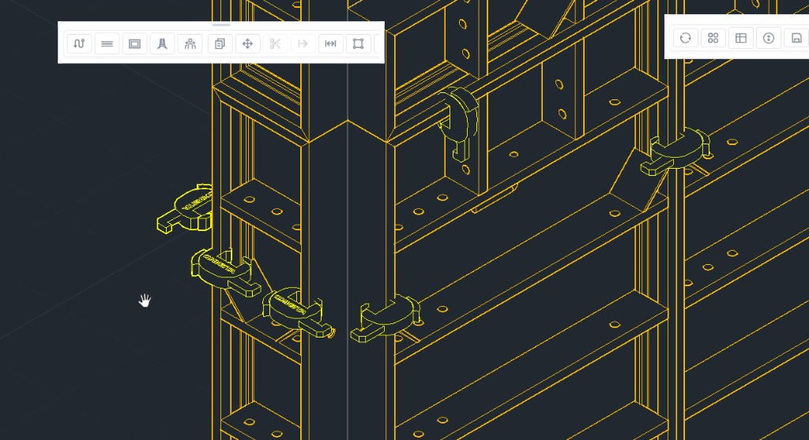
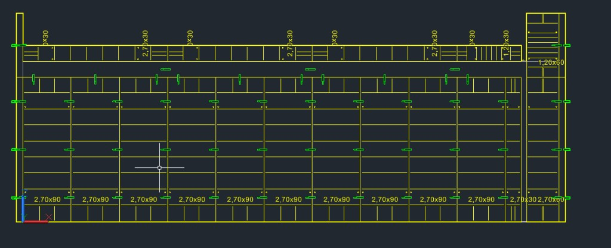
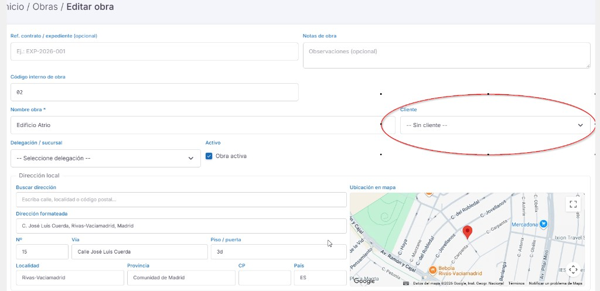

# Informe semanal — 26 de octubre a 2 de noviembre de 2026

**Periodo:** 26 de octubre – 2 de noviembre de 2026.  
**Fichero:** `Informe Semanal 26102026-2112026`.  
**Abierto el 23 de octubre de 2026.** El 22 de octubre entra aquí porque se pidió dejar lo ya hecho. Las horas de ese día siguen cerradas en el quincenal 03 (`2026-11-04_Informe-Quincenal.md`) y no se vuelven a sumar.

## 1. Lo que se hizo el 22 de octubre

### Grapas de AutoCAD

Cerrado a las 12:32. La grapa fija `10004220` sale en `ENCOFRAR` (`Debug138`): se mueve sobre la línea de junta y el clic la deja ahí. Las dos caras llevan la marca Atenko derecha. La grapa variable no entra: aún no hay DWG.

### Formulario del muro

Abierto, a prueba desde las 9:59. El doble clic abre Modificar muro, el mismo formulario que Desing (`Scripts/MasterArticles/wall-edit-form.js`). Aceptar vuelve a generar el sólido. En `Debug134` la hilada tumbada deja de quedar elevada su propia altura. A las 12:56 el doble clic del visor volvió a abrir el formulario.

### Rigidizadores

Parón a las 15:06. `Debug141` inserta el corto `1850162` y el largo `1850163`. El DLL es `TandemAutocadPlugin/AutocadPlugin/bin/Debug141/AutocadPlugin.dll`. Falta el fijador `1850164`, la tuerca `10443020` y el bloquín. No hay DWG de esas dos piezas en `3D` ni en `3DRef`.

### Segundo trabajador

Abierto desde las 15:06. El selector ofrece `Worker.obj` y `Worker2.obj`. Las fotos están en `Content/DesignTools/Stl/Worker/`, a 480×640 y sin nombre. `Worker2` gira 180° para echar el hormigón al muro. `TextCode` ya está en develop local, producción local y producción del servidor.

### Direcciones Google

Cerrado a las 21:35. La lista es propia y no filtra por país: España, Uruguay, Argentina y el resto. Buscan «Buscar dirección» y «Dirección formateada». Al elegir, el mapa se pinta en el momento. El mismo bloque es el de obra (local y facturación), cliente, empresa y delegación. En empresa, Dirección y Dirección 2 siguen siendo texto libre.

### Editar en las fichas

Entregado a las 21:42, sin cerrar. Editar está en la tarjeta de datos de la obra, de la oferta y del cliente. La oferta abre el formulario en un cuadro. Empresa, delegación y los catálogos ya lo tenían en la cabecera.

### Horas del 22 (solo las cerradas, no se suman entre sí)

| Reloj | Tramo | Suma |
|-------|--------|------|
| Persona | Grapas, 8:45–12:32 | 3 h 47 min |
| Persona | Direcciones, 20:31–21:09 y 21:17–21:35 | 56 min |
| Cursor | Grapas, 8:45–12:24 | 3 h 39 min |
| Cursor | Direcciones, 20:31–21:08 y 21:17–21:19 | 39 min |
| **Persona** | Esos tramos | **4 h 43 min** |
| **Cursor** | Esos tramos | **4 h 18 min** |

Muro, rigidizadores, trabajador y Editar seguían abiertos al acabar el día. Su tramo no entra en esa suma.

## 2. Esta semana

### Cliente al editar la obra

- **Estado:** entregado, falta confirmación. **23 de octubre de 2026, 9:18–9:54.**
- **Persona:** **9:18–9:54**.
- **Cursor:** **9:18–9:21**.
- **Qué pasa:** en Editar obra el desplegable de cliente sale en «Sin cliente» aunque la obra tenga cliente. Hay que ver el cliente adjudicado y poder cambiarlo.

- **Cursor:** entrega **9:21**. La lista se guardaba en `ViewBag` con el mismo nombre que el campo (`LinkClient_V2`). El formulario no podía marcar la opción guardada. La lista pasa a `ClientOptions`. Si el cliente adjudicado no está activo, sigue en la lista para que se vea y se pueda cambiar. La delegación tenía el mismo fallo de nombre (`LinBranch` / `BranchOptions`). A las **9:54** se pasa a otro tema, sin recargar la pantalla.

### Recuento junto a abrir diseño

- **Estado:** cerrado. **23 de octubre de 2026, 9:54–10:41.**
- **Persona:** **9:54–10:41**.
- **Cursor:** **9:54–10:28**.
- **Qué se pide:** en las listas donde hay un icono de abrir diseño, si ese diseño tiene recuento guardado, otro icono abre un cuadro con las piezas, el peso y los m².
- **Cursor:** entrega **10:00**. El icono (lista) sale en el inicio (tabla, fotos y árboles), en los diseños de la oferta, en el árbol de ofertas de la obra y en los diseños del cliente. Si no hay piezas guardadas, no sale. El cuadro lee el recuento que ya guardaba el visor: código, nombre, cantidad, peso por unidad, peso total, m² y m² total.
- **10:08.** En «tapes» (diseño 20004) el icono salía y el cuadro decía que no había piezas. Había 633 guardadas a las 10:05. La fecha de esa tanda no coincidía al releerla y la consulta devolvía vacío. La lectura acepta 50 ms alrededor de esa fecha. Al pasar el ratón, el ojo se encendía con el recuento porque el estilo pintaba todos los iconos de la fila. Ahora solo se enciende el que está debajo del puntero. Entrega **10:18**.
- **10:25.** El cuadro pasa a DataTable, con el mismo panel que el recuento del visor (pestañas Artículos y Detalles, buscar, Excel y PDF) y el logo de la plantilla en la cabecera. Entrega **10:28**.
- **10:41.** Queda visto. Se pasa a las variables de los muros.

### Variables de los muros

- **Estado:** abierto. **23 de octubre de 2026, 10:41.**
- **Persona:** **10:41–11:37**.
- **Cursor:** **10:41–10:50**.
- **Qué se pide:** un icono en la barra azul del visor. Al pulsarlo, una lista con el id del muro y las medidas (largo, ancho y alto, solo lectura) y los mismos checks que «Modificar muro». Tres pestañas: Muro, Configurar Tapes y Configurar Puntales. En Tapes las filas quedan lo más bajas posible para que quepan las imágenes. Aceptar aplica los cambios de todas las pestañas.
- **Cursor:** entrega **10:50**. El icono (tabla) es el primero de la barra. El cuadro usa el mismo panel que el recuento, con el logo de la plantilla. En la cabecera de cada check hay una casilla que marca esa variable en todos los muros. Largo, ancho y alto no se editan. Aceptar escribe ménsulas, rigidizadores, paneles, tapes y puntales y, si el visor está en muro 3D, vuelve a pintarlos.
- **11:11.** Las filas pasan al doble: la imagen de tapes de 28 px a 56 px, y el resto de filas de unos 18 px a 36 px. Entrega **11:12**.
- **11:25.** En «Modificar muro» y en la lista sale el número de grupo, delante de las medidas. Se puede cambiar y, al aceptar, el muro (eje y caras) pasa a ese grupo. Entrega **11:30**.
- **11:37.** Se pasa a abrir el alta.

### Abrir el alta

- **Estado:** entregado, falta confirmación. **23 de octubre de 2026, 11:37–11:49.**
- **Persona:** **11:37–11:49**.
- **Cursor:** **11:37–11:42**.
- **Qué se pide:** al aceptar el alta de un diseño, una oferta, una obra u otra entidad, abrir esa ficha para trabajar en ella.
- **Cursor:** entrega **11:42**. Un diseño nuevo abre el visor. Una oferta nueva abre su espacio. Una obra, un cliente, una empresa, una plantilla, un idioma, un país, un tipo de documento, una extensión, un estado de oferta o un artículo abren su ficha. Editar una oferta que ya existe sigue en la misma pantalla. En el plugin, el diseño nuevo se abre en CAD y la obra o la oferta nuevas abren su ficha.

### Lo que queda abierto

- Formulario del muro: a prueba. No cambiar la pose del visor.
- Rigidizadores: en parón. Si se retoma, el orden es fijador `1850164`, tuerca `10443020` y después el bloquín.
- Segundo trabajador: abierto. No repintar ni quitar el giro de 180°.
- Editar en las fichas: entregado, falta confirmación.
- Cliente al editar la obra: entregado, falta recargar y confirmar.
- Recuento junto a abrir diseño: cerrado.
- Variables de los muros: entregado, falta confirmación.
- Abrir el alta: entregado, falta confirmación.
- Desglose de grupos: entregado. Falta confirmación y actualizar el modelo en Visual Studio.
- Esquinas en L: cerrado el 25 oct a las 14:16. El método está en `Desing/IA/docs/esquina-L-atk60.md`. La T, el cruce y los pilares embebidos van después, con los mismos puntos.
- Grapas de la esquina: cerrado el 25 oct a las 17:10. La grapa va donde dos paneles se tocan, y en el canto del angular. El tablón queda en el sobrante exterior.
- Panel del tape: cerrado el 25 oct a las 18:50. El bastidor del cierre mira hacia fuera.
- Remates: cerrado el 25 oct a las 20:29. El tablón del eje mide el hueco de los módulos.
- Remate menor de 0,15: cerrado el 26 oct a las 10:18. El de 0,25 del muro 1 pasa a 0,10. El 0,90 pasa a 1,05. El muro 4, de 8,25, se queda en tres de 2,70 y un tablón de 0,15. Falta un testeo más a fondo.
- Muro sin las dos conexiones: cerrado el 26 oct a las 10:51. Un 8,25 suelto es dos de 2,70, uno de 2,40 y un panel de 0,45, sin tablón. Con las dos conexiones el tablón de 0,15 se queda.
- Cotas: cerrado el 27 oct a las 8:06. Acotar pinta total, a ejes, parcial, paneles, remates e id. En el listado de muros, la pestaña Acotar deja cada muro acotado o no. La noche no se suma: el 26 acaba a las 16:56.
- Altura del muro: cerrado el 27 oct a las 9:05. Al abrir Modificar muro, la altura solo cambia el muro editado. Si se marca la casilla, va a todos.
- Conexiones al generar el muro 3D: cerrado el 27 oct a las 10:21. Al generar el muro 3D se cierran las uniones y después se levanta. Las esquinas del sólido van en `#A9F527`.
- Esquinas en T: abierto el 27 oct a las 10:21. Primero las líneas y los puntos del dibujo, para hablar. Sin paneles.
- Direcciones: cerradas. No volver a filtrar por país.

### Esquinas con angulares

- **Estado:** cerrado. **25 de octubre de 2026, 14:16.**
- **Persona:** inicio **23 oct 13:25**, fin **25 oct 14:16**. El reloj siguió abierto; no se suma de un tirón.
- **Cursor:** **13:25–13:27**, **13:31–13:33**, **13:33–13:43**, **14:04–14:25**, **16:13–16:30**, **17:38–17:41**, **18:03–18:08**, **18:22–18:25**, **18:36–18:41**, **18:52–19:02**, **20:07–20:09**, **20:48–20:56**, **23:25–23:27** y, el **24**, **9:14–9:21**, **9:36–9:49**, **10:12–10:13**, **10:18–10:20**, **10:31–10:37**, **10:41–10:53**, **10:53–11:00**, **11:02–11:04**, **11:05–11:07**, **11:11–11:16**, **11:40–11:49**, **11:56–12:01**, **12:07–12:14**, **15:10–15:21**, **15:50–15:52**, **15:58–16:11**, **16:15–16:25**, **16:46–16:55**, **21:16–21:22**, **21:33–21:39** y, el **25**, **8:49–9:02**, **9:10–9:18**, **10:22–10:28**, **10:36–10:39**, **10:41–10:42**, **10:47–10:48**, **10:52–10:53**, **11:10–11:13**, **11:18–11:46**, **12:13–12:33**, **12:40–12:45**, **13:54–13:57** y **14:16–14:24**.
- **Qué se pide:** estudiar la solución de esquinas con angulares. Cómo se parten los muros, la documentación de módulos y remates, y cómo lo hacía el Desing antiguo: dónde van el angular, el panel de esquina, los paneles y los remates. Hay tres soluciones; esta es la primera.
- **Cursor:** entrega **13:27**. Estudio, sin cambiar el encofrado. El muro se parte en módulos de 2,70, un módulo final y un remate de madera, penúltimo y de 0,15 m como máximo. En la esquina 50 del Desing antiguo el trozo de esquina mide el espesor más 3 cm, en pasos de 1,5 cm (de 4,5 a 18 cm). Con angulares, el perfil va en el extremo y el panel de esquina en la otra cara. Lo que sobra de esa pieza, descontando el panel de 0,30 y el espesor del otro muro, sale como remate de madera.
- **13:31.** El remate de una cara y el de la otra pueden medir distinto, y hay que unirlos con el del muro de al lado. El Desing antiguo no lo hacía: un solo largo y un solo taco. En planta el inglete ya deja cada cara con su largo. El encofrado actual ignora eso y parte el eje, el mismo remate en las dos caras. Entrega **13:33**.
- **13:33.** Implementado. Cada cara manda su largo. El remate es el resto de esa cara. Si en la esquina se toca con la cara del otro muro, los dos restos se suman y el taco se pinta una sola vez, en el muro de id menor. La otra cara puede quedar con otra medida. Los paneles siguen en el eje. Entrega **13:43**.
- **14:04.** En la esquina en L no salía el encofrado: ni la cara interior, ni el angular, ni las grapas. El Desing antiguo se dejaba grapas. El manual (NEVI, marcas de los paneles) pone la grapa fija a 550 mm del pie y de la cabeza en 2,70 y en 2,40, y a 350 mm en el de 1,20. En 2,70 el paso es 550 + 800 + 800 + 550, así que también va la del medio, a 1 350 mm. Entrega **14:25**. La esquina en L reserva 300 mm, que es la pata del panel de esquina. Por fuera va ese panel. Por dentro, el angular. Las grapas van en las dos caras y en los dos muros, en esos taladros. Si el muro apila más de un curso, el rigidizador corto va en la junta.
- **16:13.** El panel de esquina y el angular salían estirados y tumbados. El STL mide la altura en Z (2,70 m) y las patas en planta (0,30 m el panel, 0,12 m el angular). El visor los trataba como un panel plano y dividía 2,70 entre ese canto. Entrega **16:30**. Quedan a su tamaño, de pie. El panel cierra por fuera, en el vértice exterior. El angular cierra por dentro. El giro de planta va en el eje vertical del visor. Los paneles rectos del muro no se tocan.
- **17:38.** La pieza amarilla se metió en la esquina y ocupó el hueco de la esquina interior, en el sitio del angular. El muro tiene que encofrarse como antes. Los remates se dejan; se ajustan luego según el espesor. Entrega **17:41**. El muro vuelve a reservar 450 mm en el nudo, como el resto de esquinas. El angular queda en el extremo del muro, sobre la cara, como en el Desing antiguo. El panel de esquina va por fuera. La esquina interior se queda en el hueco.
- **18:03.** El muro ya está como antes. Hay que poner el angular y las grapas que lo unen a los paneles de la esquina. Entrega **18:08**. Con el hueco de 450 mm la esquina no se detectaba, porque la pieza solo buscaba 300 mm, y no salía nada. Ahora el angular va en el extremo de los paneles, sobre la cara de fuera. En cada cara, el panel de esquina avanza 300 mm hacia el hueco. Las grapas fijas van en esa junta, en las dos caras y en los dos muros.
- **18:22.** En el Desing antiguo el angular va en el corner de la esquina. En lo que se pinta ahora está en el extremo del panel. El punto rojo pequeño marca el vértice. Entrega **18:25**. El muro no se toca. El angular pasa al cruce de las dos caras de fuera, en ese vértice. Los paneles de esquina y las grapas se quedan en la junta.
- **18:36.** El angular y los paneles de esquina salen dentro del muro: el giro mete el cuerpo del perfil en el hormigón. Entrega **18:41**. El vértice no se mueve. Media vuelta en planta saca las patas hacia fuera. El muro sigue igual.
- **18:52.** El angular ya está bien. El panel de esquina tiene que ir en el cruce de los dos muros, el punto rojo, y girado como en el Desing antiguo. Entrega **19:02**. El angular no se mueve. Había dos paneles, cada uno a lo largo de un muro. Queda uno solo: la piel se cruza en el origen del STL y ese punto cae en el cruce. El bastidor mira hacia fuera.
- **20:07.** El panel de esquina sale girado y asoma fuera del cruce. Hay que girarlo 90° en sentido horario y dejarlo en el círculo rojo. Entrega **20:09**. El angular y el muro no se tocan. El panel sigue en el cruce y gira 90° en sentido horario.
- **20:48.** El giro ya vale. Los dos puntos rojos tienen que coincidir: el del panel va a la intersección de los dos muros. Entrega **20:56**. El angular no se mueve. El canto de la pata, a 300 mm del origen, cae en el cruce.
- **23:25.** Esos 300 mm son el espesor del muro, y hay dos. En este caso los dos son 300, pero uno puede ser 265 y el otro 167, o cualquier medida. Entrega **23:27**. El angular no se mueve. Un eje del panel usa el espesor de un muro y el otro eje el del otro.
- **24, 9:14.** Ese desplazamiento rompió el giro de la esquina interior y no la dejó en el cruce. Entrega **9:21**. El giro vuelve al de las 20:09, el que ya cuadraba. El vértice se mueve en el mundo con el espesor de cada muro. El angular no se toca.
- **24, 9:36.** El giro ya está bien. Falta correr el panel en el eje Y el espesor del muro horizontal. Entrega **9:49**. El giro no se toca. En el eje Y de planta el panel retrocede el espesor de ese muro. El angular sigue igual.
- **24, 10:12.** El eje era el otro. Hay que dejar el código como antes de ese cambio y correr la esquina en el eje X el espesor del muro vertical. Entrega **10:13**. Se quita el corrimiento en Y. En el eje X el panel retrocede el espesor del muro vertical. El giro y el angular no se tocan.
- **24, 10:18.** En X salió hacia fuera del muro: el espesor iba en negativo. Entrega **10:20**. El mismo espesor del muro vertical pasa a positivo. El giro y el angular no se tocan.
- **24, 10:31.** El sitio ya vale. El angular y la esquina interior tienen que verse un poco más oscuros que los paneles. En la cara A y en la cara B hay que meter el panel que quepa (0,30, 0,45, 0,60, 0,75, 0,90 o la suma) y las grapas que unen ese panel con el angular. Entrega **10:37**. El sitio y el giro no se tocan. El amarillo del angular y el de la esquina interior bajan un poco; los paneles del muro siguen igual. Cada cara mide su hueco y lo rellena con esos anchos, pegado al angular. La grapa fija va en esa junta, en las dos caras de cada muro.
- **24, 10:41.** En el panel de la esquina hay tres grapas de más, marcadas en verde, dentro del vano. Entrega **10:53**. Se quitan. Queda la grapa de la junta con el panel de al lado.
- **24, 10:53.** Esas grapas están a la altura del tirante y chocan. El manual NEVI 3.1.1 pone tres en el de 2,70, dos en el de 2,40 y dos en el de 1,20, en la junta, no en el agujero. Entrega **11:00**. El de 2,70 pasa a 450, 1 350 y 2 250 mm. El de 2,40 a 400 y 2 000. El de 1,20 a 200 y 800. El tirante no se mueve. Queda escrito en `Desing/IA/docs/agente-grapas-atk60.md`.
- **24, 11:02.** El resto del manual: compensación, escuadra G, junta horizontal y la grapa de más junto a la esquina de 90° y al tape. Entrega **11:04**. No se pinta nada nuevo: el manual no da la altura de esa grapa de más. Queda la base en el mismo documento.
- **24, 11:05.** La grapa del panel tumbado no se había cambiado. Entrega **11:07**. La junta horizontal usa las mismas estaciones que el panel de pie, sobre el lado largo.
- **24, 11:11.** Al quitar las grapas del vano se fueron también las del angular. Entrega **11:16**. Vuelven a la junta del angular, a 450, 1 350 y 2 250 mm.
- **24, 11:40.** Un muro de 0,22 contra uno de 0,30 pintaba dos remates, uno por dentro y otro por fuera, y grapas fijas en esa unión. Entrega **11:49**. Esos dos remates salen. El escalón, 80 mm, se cierra con un tablón y grapas variables. Las grapas fijas de esa unión no se pintan. Las del angular se quedan. El otro extremo, si el vecino tiene otro espesor, es el mismo caso con ese vecino. El JSON se deja para cuando los dos extremos escalonen a la vez.
- **24, 11:56.** El tablón no se veía: estaba dentro del hormigón, y las grapas fijas del cruce seguían en la cara. Entrega **12:01**. El tablón pasa a la cara de fuera, al extremo del muro grueso, con las grapas variables. En ese cruce las grapas fijas del angular no se pintan.
- **24, 12:07.** El tablón y las grapas variables no estaban en el interior. En la otra esquina, 0,30 contra 0,46, el panel de esquina salía hacia fuera y el hueco se tapaba con un panel de muro. Entrega **12:14**. El tablón y las grapas variables van también en la cara de dentro. El panel de esquina mira hacia el cuerpo del muro. Ese hueco de 160 mm no lleva un panel de 0,45.
- **24, 15:10.** En el muro entre dos esquinas, el extremo de 0,47 no aplicaba la regla: 0,47 más la esquina de 0,30 son 0,77, el exterior sube a 0,90 y el interior se queda en un remate de 0,13. Entrega **15:21**. Ese extremo del muro se acorta de 0,45 a 0,90. Ahí va el panel de 0,90 por fuera y el remate de madera por dentro. La otra esquina, en paneles, no se toca. Las grapas de unión siguen para después.
- **24, 15:50.** El recorte de 0,90 se aplicó también a la primera esquina y le metió un remate que no tocaba. La segunda no quedaba como la cota del muro. Entrega **15:52**. Solo el extremo que sube a 0,90 se redimensiona. La primera esquina vuelve al recorte de 0,45, sin ese remate.
- **24, 15:58.** El muro gris seguía el diseño antiguo: la cara A de la segunda esquina medía 0,30, el panel de esquina, y tiene que medir 0,90. Entrega **16:11**. Esa cara sale del espesor del otro muro más 0,30. 0,47 + 0,30 son 0,77, así que la cara queda en 0,90 y el muro recto se acorta hasta ahí.
- **24, 16:15.** El muro ya estaba bien y faltaba encofrarlo. Entrega **16:25**. El encofrado recto para donde para el muro gris. En la cara de 0,90 va el panel por fuera y, por dentro, el remate de 0,13.
- **24, 16:46.** En la segunda esquina no salían el angular ni la esquina interior: el muro acaba más lejos de 0,45 y el cruce no se veía. Entrega **16:55**. Esas dos piezas vuelven al mismo sitio de antes.
- **24, 21:16.** El panel de esquina salía por fuera de la cara del muro vertical, en las dos esquinas. Entrega **21:22**. El angular y el giro no se tocan. El panel vuelve a esa cara.
- **24, 21:33.** El panel quedó peor y los remates no salen. Entrega **21:39**. El panel no se mueve. Arriba de cada esquina hay una esfera verde de 5 mm en el punto de inserción y una roja del mismo tamaño en el cruce de las dos caras.
- **25, 8:49.** Las dos esferas estaban mal. La roja no es el cruce de la cara A con la cara B: ese cruce es el punto azul. Entrega **9:02**. Las dos esferas pasan a 15 mm. La roja entra 120 mm por cada cara, hasta el talón. La verde se queda. El panel y el angular no se mueven.
- **25, 9:10.** La roja no cayó en el punto azul: se quedó a medio camino, fuera del rincón de la L. Entrega **9:18**. La roja pasa al vértice local 120 mm por 180 mm de esa L. La verde, el panel y el angular no se mueven.
- **25, 10:22.** Los puntos del encofrado no sirven para hablar del cruce. Entrega **10:28**. Salen al generar el muro 3D, no al encofrar. Solo el punto rojo, en el cruce de las dos caras de fuera. En la cara de arriba de cada esquina van cuatro líneas, la 1 y la 2 en una cara y la 3 y la 4 en la otra. El punto verde se deja para después.
- **25, 10:36.** La 2 y la 4 estaban en el canto de fuera. Entrega **10:39**. La 1 y la 3 siguen en el canto exterior. La 2 cruza por dentro, paralela a la 1. La 4 cruza por dentro, paralela a la 3. El punto rojo no se mueve.
- **25, 10:41.** Los números salían encima del muro y no se sabía cuál era cuál. Entrega **10:42**. Cada número pasa a su línea de cota, fuera de la esquina. La 1 queda junto a su canto y la 2 un poco más afuera. Igual la 3 y la 4.
- **25, 10:47.** La cota roja y la azul oscura estaban en el mismo lado que la cian y no se distinguían. Entrega **10:48**. Esas dos cotas pasan al lado contrario. El número queda del color de su línea.
- **25, 10:52.** El punto rojo estaba en el cruce de la 1 con la 3. Entrega **10:53**. Pasa al cruce de la 4 con la línea roja, el punto naranja.
- **25, 11:10.** El punto rojo ya vale. Toca el de la esquina interior. Al encofrar, las líneas y las cotas tienen que desaparecer y quedarse solo los puntos. Entrega **11:13**. El rojo no se mueve. El verde sale arriba, en el sitio donde ahora se inserta la esquina interior, del mismo tamaño. Al encofrar se ocultan las líneas, las cotas y los números. Los dos puntos siguen.
- **25, 11:18.** El verde, que es la inserción de la esquina, tiene que ir al punto naranja y coincidir con el rojo. Entrega **11:46**. El rojo no se mueve. El origen de la esquina interior pasa a la esquina interior del muro, el mismo sitio que el rojo. El giro no se toca.
- **25, 12:13.** El punto de inserción no es el origen verde: es el extremo del panel, el naranja. Entrega **12:33**. El verde se queda. En los paneles de 1,20, 2,40 y 2,70 ese extremo pasa al verde. El giro y el rojo no se tocan.
- **25, 12:40.** La inserción cayó en el otro extremo. Entrega **12:45**. Pasa al extremo de la otra pata, el que estaba marcado en naranja. El verde, el giro y el rojo no se mueven.
- **25, 13:54.** El verde ya es la inserción. El panel tiene que ir al rojo. Entrega **13:57**. El panel se traslada y el verde cae en el rojo. El extremo de inserción, el giro y el rojo no se tocan.
- **25, 14:16.** La esquina en L queda cerrada. El método, para repetirlo en la T, el cruce y los pilares embebidos, está en `Desing/IA/docs/esquina-L-atk60.md`: primero el muro 3D, líneas y el punto rojo, luego el verde en el vértice que se marque, y al final se hace coincidir el verde con el rojo. Entrega **14:24**. Las ayudas de puntos y líneas solo salen con `juan.godoy@vscad.com`, hasta que existan los roles. El panel, el giro y el angular no se tocan.

### Grapas de la esquina

- **Estado:** cerrado. **25 de octubre de 2026, 17:10.**
- **Persona:** inicio **14:31**, fin **17:10**.
- **Cursor:** **14:31–14:50**, **15:02–15:09** y **15:27–15:32**.
- **Qué se pide:** en la esquina faltan las grapas marcadas en rojo. Al aplicar el manual se quitaron. El sitio de antes era el bueno. La altura no.
- **Cursor:** entrega **14:50**. Vuelven al canto de la esquina, en las dos caras. En el de 2,70 van a 450, 1 350 y 2 250 mm. El panel, el giro y el angular no se tocan.
- **15:02.** Esas grapas cayeron en el angular. Los círculos estaban en las juntas de los paneles. Cada vez que dos paneles se tocan, esa junta lleva su grapa. Entrega **15:09**. La del panel de esquina queda a 300 mm del angular, hacia el muro. Si la cara se parte en varios paneles, cada corte lleva la suya. La del angular se queda. Queda escrito en `Desing/IA/docs/agente-grapas-atk60.md`.
- **15:27.** Esas grapas de los 300 mm caen en el vano: ahí no hay dos paneles. El tablón y las grapas variables no están en el remate. Entrega **15:32**. Salen las del vano. El tablón pasa al sobrante exterior de la cara y las variables van en sus cantos. El remate que seguía en el extremo recortado del eje se quita.
- **17:10.** Queda aceptado. Se pasa al panel del tape.

### Panel del tape

- **Estado:** cerrado. **25 de octubre de 2026, 18:50.**
- **Persona:** inicio **17:10**, fin **18:50**.
- **Cursor:** **17:10–17:21**.
- **Qué se pide:** el panel de cierre del tape sale girado 180°. Se ve la cara lisa y el bastidor queda contra el hormigón.
- **Cursor:** entrega **17:21**. El yaw del panel pasa al signo contrario para que el bastidor mire hacia fuera. El origen en el espesor no se mueve. Las placas del TapeS3 y el giro del inicio del TapeS1 no se tocan.
- **18:50.** Queda aceptado. Se pasa a los remates.

### Remates

- **Estado:** cerrado. **25 de octubre de 2026, 20:29.**
- **Persona:** inicio **18:50**, fin **20:29**.
- **Cursor:** **18:50–19:07**.
- **Qué se pide:** los remates que antes encajaban salen desplazados. En la foto el taco no sigue la cara: en los extremos y en el rincón.
- **Cursor:** entrega **19:07**. El tablón del eje usa el hueco de los módulos, no el resto de la cara del diseño. En la esquina el sobrante va a continuación de los paneles, en la misma cara.
- **20:29.** Se pasa al remate de más de 0,15.

### Remate menor de 0,15

- **Estado:** cerrado. **26 de octubre de 2026, 10:18.** Falta un testeo más a fondo.
- **Persona:** inicio **25 oct 20:29**, fin **26 oct 10:18**. La noche no se suma. El 25 acaba en la última entrega, a las **21:17**. Sigue el **26 oct a las 9:14**.
- **Cursor:** **20:29–20:35**, **20:47–20:49**, **21:05–21:17**, **26 oct 9:14–9:28**, **9:35–9:40** y **10:07–10:11**.
- **Qué se pide:** en el muro 1 el tablón mide 0,25. Con los paneles tiene que quedar por debajo de 0,15. El 0,90 pasa a 1,05, que son 0,75 y 0,30.
- **Cursor:** entrega **20:35**. Si el tablón llega a 0,15, se suma un paso de 0,15 al panel. El 0,90 pasa a 1,05 y el tablón baja 0,15.
- **20:47.** En el muro 4, de 8,25, salieron paneles de más. La solución es tres módulos de 2,70 y un tablón de 0,15. Un tablón de 0,15 se queda. Un 2,70 no se parte. Entrega **20:49**.
- **21:05.** El muro 4 seguía igual: en la esquina, al lado del 0,60, había un 0,45. La esquina se cierra con el panel de 0,60. El resto del muro es un solo módulo, el mayor que quepa, y no se parte en 1,20 y 0,45. Entrega **21:17**.
- **26 oct, 9:14.** En el muro 4 hay un tablón en cada esquina, al lado del panel, metido donde va el angular. Ese hueco es del angular. El módulo de esquina llega hasta el canto y el tablón no se dibuja ahí. Entrega **9:28**.
- **9:35.** El tablón de la esquina va entre la esquina interior y el panel, con las grapas variables. Las grapas fijas de ese hueco, que no unen dos paneles, se quitan. Pasa en las dos esquinas. Entrega **9:40**.
- **10:07.** En una esquina las grapas variables salen boca abajo. En la cara de detrás se les da medio giro para dejarlas de pie. La otra esquina no se toca. Entrega **10:11**.
- **10:18.** Queda aceptado. Falta un testeo más a fondo.

### Muro sin las dos conexiones

- **Estado:** cerrado. **26 de octubre de 2026, 10:51.**
- **Persona:** inicio **10:36**, fin **10:51**.
- **Cursor:** **10:36–10:40** y **10:51–10:53**.
- **Qué se pide:** un muro se clasifica por las conexiones de sus extremos. Ninguna, una, o las dos. En el diseño solo hay un muro de 8,25 m, sin conexiones. Si el largo es múltiplo de 0,15 y el muro no tiene las dos conexiones, no hay tablón: el desencofrado sale por el tape. El 8,25 son dos módulos de 2,70, uno de 2,40 y un panel de 0,45. Con conexión en los dos extremos, si el espesor no pide tablón, se queda el reparto de ahora.
- **Cursor:** entrega **10:40**. El muro suelto de 8,25 pasa a dos de 2,70, uno de 2,40 y un panel de 0,45. Sin tablón. Con una sola conexión se hace lo mismo si el largo, ya recortado, es múltiplo de 0,15 y sobraban 0,15. Con las dos conexiones el tablón de 0,15 se queda.
- **10:51.** Queda aceptado. El reparto está en `Docs/Proyectos/Desing/ATK60-Logica-Modulos-Wall.md`, y la frase del tablón de esquina queda alineada en `esquina-L-atk60.md` y `agente-grapas-atk60.md`. Entrega **10:53**.

### Cotas

- **Estado:** cerrado. **27 de octubre de 2026, 8:06.**
- **Persona:** inicio **26 oct 11:09**, fin **27 oct 8:06**. La noche no se suma. El 26 acaba en la última entrega, a las **16:56**.
- **Cursor:** inicio **26 oct 11:09**, fin **16:56** (última entrega). Entrega del selector **11:33**.
- **Qué se pide:** estudiar la documentación de Desing de octubre de 2026 y empezar con las cotas. Las cotas actuales se pisan unas a otras. Hacen falta apartados que puedan crecer. El botón Acotar pasa a la barra azul, al lado de las variables de los muros. El clic muestra u oculta. Si se mantiene pulsado, sale un segundo botón abajo y, a su lado, un selector pequeño con el estilo del recuento.
- **Cursor:** estudio, sin tocar código. Hay cuatro cotas distintas. La de la línea (longitud, ΔX y ΔZ, editables). La de **Acotar muro** (`#ma-stl-tool-wall-dim`): longitudes del contorno por el oeste y el sur, cota global si no repite un tramo, espesor, y en los nudos L/T el panel en cian y el remate en ámbar. Las de modulación del encofrado, en horizontal y pegadas a la de longitud; la vertical quedó para después y se apagan al salir del modo encofrado. Las ayudas de la L (líneas 1 a 4 y sus cotas), solo para Juan, y se ocultan al encofrar.
- **11:26.** El selector, antes de filtrar el dibujo. Entrega **11:33**. Acotar queda en la barra azul, a la derecha de la tabla de muros. El clic corto sigue mostrando u ocultando las cotas de ahora. Mantener 1,5 s saca el botón de tipos en la barra inferior. Ese botón abre el cuadro al lado: cabecera en el color de la plantilla, logo y seis casillas (Muros Totales, Muros Parciales, Dimensión de Paneles, Remates, Referencia Anchor Point, Panel Regulable). Salen marcadas. La elección se guarda en la sesión. Aún no cambia lo que se pinta.
- **11:41.** El botón de abajo no salía. La pulsación se cortaba al capturar el puntero. Entrega **11:44**. La espera de 1,5 s ya no se cancela si el puntero se mueve un poco. Hay que recargar el visor.
- **11:49.** Seguía sin salir: un suelte fantasma al pulsar cortaba la espera. Entrega **11:55**. La espera vive en el mismo botón de Acotar. Un suelte de menos de 80 ms no la corta. Hay que recargar el visor con F5.
- **12:00.** El mantener pulsado se deja. El doble clic abre el cuadro. Entrega **12:04**. Acotar, un clic, muestra u oculta. Dos clics seguidos abren el formulario en el centro, con el logo y las seis casillas. Se cierra con la X, con Escape o pulsando fuera. Las casillas siguen sin filtrar el dibujo. Hay que recargar el visor con F5.
- **12:10.** Casilla nueva, Id de Muro, y el cuadro se mueve. Entrega **12:10**. Se arrastra por la cabecera azul; la X sigue cerrando. Id de Muro sale marcado, como el resto, y se guarda en la sesión. Todavía no pinta esa cota. Hay que recargar el visor con F5.
- **12:29.** Tres cotas de muro, en todos los muros. Entrega **12:35**. Total: de cara exterior a cara exterior. A ejes: de eje a eje. Parcial: el espesor de cada encuentro y el tramo entre las caras interiores. Si las tres están marcadas, la parcial queda la más pegada al muro, a ejes en medio y el total la más fuera, para que no se pisen. En un extremo libre no se añade espesor. Espesor, tramos, cota global, paneles, remates y alturas dejan de pintarse. El id de muro solo sale si su casilla está marcada. Al cambiar una casilla, con Acotar activo, se redibuja. Hay que recargar el visor con F5.
- **12:36.** Que solo se vean esas tres. Entrega **12:38**. Con Acotar activo no sale el id del muro, ni la cota de la línea al pasar el ratón, ni las ayudas de la esquina en L. Al salir de Acotar vuelven la cota de la línea y las ayudas. Hay que recargar el visor con F5.
- **12:43.** Un muro solo, el de 8,25, salía tres veces. Entrega **12:44**. Si no tiene encuentros, solo se pinta el total. Hay que recargar el visor con F5.
- **12:45.** La parcial de la esquina salía 0,30, el espesor. Entrega **12:47**. Pasa a medir el panel de esquina: espesor del otro muro más 0,30. Con muros de 0,30, la esquina queda en 0,60 y el tramo del medio se acorta lo mismo. El total y a ejes no cambian. Hay que recargar el visor con F5.
- **12:53.** Estilo de cota de obra. Entrega **12:56**. La de esquina baja hacia el muro, separada del tramo largo. Las flechas quedan iguales en todas. Línea y número en azul, sin la pastilla. Hay que recargar el visor con F5.
- **13:00.** El 0,60 no cabe en el tramo. Entrega **13:02**. El número de la esquina sale fuera de la línea, pasado el extremo. Hay que recargar el visor con F5.
- **13:01.** Flecha por trazo oblicuo. Entrega **13:03**. UNE 1039: en obra el extremo es un trazo corto a 45°, el mismo en todo el dibujo. Las cotas de muro lo usan. Hay que recargar el visor con F5.
- **13:09.** No cruzar las líneas de cota. Entrega **13:12**. La línea se corta antes del cruce. Se sigue entendiendo que llega al eje. Hay que recargar el visor con F5.
- **13:13.** El total acota también el ancho. Entrega **13:16**. El número que no cabe sale por fuera, encima de la línea, y la línea sigue hasta el final del texto. Líneas y texto en negro. Hay que recargar el visor con F5.
- **13:22.** La cota que se monta en la esquina pasa a la izquierda o a la derecha, al lado que queda libre. Entrega **13:30**. Clic en la cota para cambiarla: solo el total, el eje y el espesor. La parcial no se edita. Hay que recargar el visor con F5.
- **13:36.** El 0,60 que caía sobre el muro se queda fuera. Entrega **13:42**. El 0,75 en vertical gira 90° para estorbar menos. Hay que recargar el visor con F5.
- **13:41.** Al editar una cota, el resto queda al 50% y el círculo de esa cota se duplica. Entrega **13:45**. Escape o Intro devuelven la vista. Hay que recargar el visor con F5.
- **13:47.** El 0,60 sube a la línea de la cota continua, a continuación. Entrega **13:52**. Se borra el tramo de la cota a ejes que la cruzaba. Hay que recargar el visor con F5.
- **13:57.** El número se separa más de la línea. Entrega **14:02**. El texto vertical gira 180° para leerse, y los números de los muros verticales también giran. Al editar, el número conserva la altura, el círculo crece solo un poco y el borde queda fino. Hay que recargar el visor con F5.
- **14:06.** El 0,60 de la esquina vuelve dentro del tramo, encima de la línea. Entrega **14:08**. Hay que recargar el visor con F5.
- **14:09.** El 0,60 no va en el centro: queda junto al tramo, a la derecha en un extremo y a la izquierda en el otro. Entrega **14:11**. Hay que recargar el visor con F5.
- **14:17.** El 0,60 que no cabe se mete dentro de la cota de al lado. Entrega **14:20**. Hay que recargar el visor con F5.
- **14:20.** Al girar la vista, el número sigue la cota y solo se da la vuelta 180° si quedaría boca abajo. Entrega **14:24**. Hay que recargar el visor con F5.
- **14:28.** Dimensión de paneles activada, pegada al muro. Entrega **14:32**. Si hay alguna cota de muro, esa crece hacia afuera para no solaparse. Hay que recargar el visor con F5.
- **14:36.** Dos líneas: módulos 2,70, 2,40 y 1,20, y delante los paneles 0,30 a 0,90. Entrega **14:42**. El 0,12 no se acota. La altura, una vez por fila. Hay que recargar el visor con F5.
- **14:42.** El angular (0,12) no se acota: no encofra, es una pieza de unión. Queda para la documentación.
- **14:50.** Primero la fila de paneles y después la de módulos. Entrega **14:56**. Mismo estilo que los muros: sin flechas ni círculo, mismo tamaño, no editables. El número de muro vuelve a su línea, la corta y deja un poco de margen. Hay que recargar el visor con F5.
- **15:02.** Los paneles pequeños se pisaban. Entrega **15:12**. El 0,30 y el 0,45 pasan hacia el muro; el 0,60 y el 0,75 salen hacia afuera. Si dos cortos van seguidos, se alternan. El número que no cabe sale fuera del tramo, encima de la línea, y la línea sigue hasta el final del texto. En esa fila se quita el cero de más: 0,3, 0,6 y 0,9; 0,45 y 0,75 se quedan con dos decimales. Los módulos y los muros no cambian. Hay que recargar el visor con F5.
- **15:18.** Las cotas editables en azul oscuro. Entrega **15:21**. Total, a ejes y espesor: número y línea. El resto sigue en negro. Hay que recargar el visor con F5.
- **15:40.** La cota que no cabe sale a 45°. Entrega **15:44**. Un punto marca el sitio y una línea inclinada lleva el número fuera. Si otra va a cruzarla, cambia de lado o de largo. El 0,90 y las cotas largas siguen en su línea. Hay que recargar el visor con F5.
- **15:54.** Vuelven las líneas de 0,90. Entrega **15:57**. El punto queda a la mitad. Los paneles llevan dos decimales: 0,90, 0,30, 0,75. Al acercar el zoom, si el número cabe, entra en la cota y desaparece la línea a 45°. Hay que recargar el visor con F5.
- **16:05.** Cotas de remate. Entrega **16:09**. El tablón de remate se acota en la fila de paneles, con dos decimales. Si el número no cabe, sale a 45° con el punto. La casilla Remates lo enciende o lo apaga. Hay que recargar el visor con F5.
- **16:15.** La cota de remate lleva la palabra remate. Entrega **16:18**. El id de muro se activa: punto en el centro del muro, a mitad del espesor, y una línea a 45° que pasa los elementos hasta el texto. Hay que recargar el visor con F5.
- **16:24.** Referencia de anchor point y cookie por diseño. Entrega **16:26**. El origen del muro lleva un punto y una línea a 45° hasta el texto AP. Las casillas de cotas se guardan en una cookie de ese diseño. Hay que recargar el visor con F5.
- **16:30.** Fuera el apartado de anchor point del cuadro. Entrega **16:32**. Esa referencia ya no se dibuja. Hay que recargar el visor con F5.
- **16:38.** Pestaña Acotar en Modificar muro. Entrega **16:46**. La casilla guarda `Is_CheckDimWall`. Un muro nuevo nace acotado, sin ménsulas y sin puntales inferiores. Hay que recompilar, ejecutar el script de la columna y recargar con F5.
- **16:47.** Script de `Is_CheckDimWall` ejecutado en local, producción y develop. Entrega **16:48**. En producción, 56 muros activos quedan acotados. Develop no tenía muros. El valor por defecto de la columna pasa a 1.
- **16:53.** Pestaña Acotar en el listado de muros. Entrega **16:56**. Cada muro tiene la casilla, marcada por defecto. Aceptar guarda el valor. Hay que recargar el visor con F5.

### Altura del muro

- **Estado:** cerrado. **27 de octubre de 2026, 9:05.**
- **Persona:** inicio **8:40**, fin **9:05**.
- **Cursor:** inicio **8:40**, fin **8:46**.
- **Qué se pide:** en Modificar muro, la casilla que decide si la altura cambia solo en el muro seleccionado o en todos no limita el cambio. Siempre se aplica a todos.
- **Cursor:** entrega **8:46**. Al abrir el formulario, «Aplicar altura a todos los muros» salía marcada, y Aceptar escribía esa altura en todos. Ahora sale desmarcada: solo cambia el muro que se está editando. Si se marca, sigue yendo a todos. Hay que recargar el visor con F5.

### Conexiones al generar el muro 3D

- **Estado:** cerrado. **27 de octubre de 2026, 10:21.**
- **Persona:** inicio **9:05**, fin **10:21**.
- **Cursor:** inicio **9:05**, fin **9:33**.
- **Qué se pide:** antes de la esquina en T, arreglar el plano. Al pulsar Generar muro 3D, primero se cierran las uniones y después se levanta el sólido. El boceto enseña tres casos: la L del extremo no cierra, la T se queda corta y el cruce atraviesa sin partirse.
- **Cursor:** entrega **9:09**. Generar muro 3D acerca el extremo que se queda corto, parte el cruce y cierra los ingletes, y no vuelve a fundir el tramo que tiene otro muro en ese punto. Luego levanta. Hay que recargar el visor con F5.
- **Cursor:** entrega **9:20**. La esquina del sólido deja el ámbar y pasa al mismo verde claro, tirando a azul, que el tramo recto. Hay que recargar el visor con F5.
- **Cursor:** entrega **9:25**. Todas las esquinas del sólido (L, T y cruce) pasan a `#F54927`. Hay que recargar el visor con F5.
- **Cursor:** entrega **9:33**. Las esquinas del sólido pasan a `#A9F527`. Hay que recargar el visor con F5.

### Esquinas en T

- **Estado:** abierto. **27 de octubre de 2026, 10:21.**
- **Persona:** inicio **10:21**.
- **Cursor:** inicio **10:21**.
- **Qué se pide:** igual que en la L, primero la línea y los puntos sobre el muro 3D, para poder hablar y colocar los paneles. La imagen trae el Tipo 1 con caras y puntos, y el Tipo 2 y el Tipo 3 solo en contorno.
- **Cursor:** entrega **10:23**. Estudio de la imagen, sin código y sin documento. La conversación para dejarlo escrito empieza ahora.
- **Cursor:** entrega **10:29**. Tipo 1, solo para Juan: caras A, B, C, D y E, punto rojo y punto azul, encima del sólido. Sin paneles. Hay que recargar el visor con F5 y generar el muro 3D.
- **Cursor:** entrega **10:37**. Fuera el contorno de la esquina. Quedan las líneas de las caras: A, B, C y D miden 0,30 m. La E mide 0,30 + 0,30 + espesor. Hay que recargar el visor con F5.
- **Cursor:** entrega **10:47**. En la T, un panel de esquina en el punto rojo y otro en el azul, con el mismo giro que en la L. Hay que recompilar y encofrar.
- **Cursor:** entrega **11:01**. Cara E: espesor + 0,30 + 0,30, sin angular. Un panel de 0,90 y, si sobra, el remate al final con grapas regulables. Si pasa de 0,90, dos paneles y el remate en medio. Hay que reiniciar el sitio y encofrar.
- **Cursor:** entrega **11:28**. Las esquinas de la T vuelven a la cara de dentro, no al cuerpo del muro. Grapa fija de unión en el encuentro del recto con la esquina y con la cara E, en las dos caras. Hay que reiniciar el sitio y encofrar.
- **Cursor:** entrega **11:38**. El giro de las dos esquinas vuelve al de la primera inserción, el que ya cuadraba. Cara E y grapas de unión se quedan. Hay que reiniciar el sitio y encofrar.
- **Cursor:** entrega **13:30**. En cada punto de la T, cuatro giros del panel de esquina, con el número 1, 2, 3 o 4. Hay que reiniciar el sitio, recargar y encofrar, y decir qué número se queda.
- **Cursor:** entrega **13:41**. Los números salen a 2 m, con un punto en su panel y una línea hasta el número. Hay que reiniciar el sitio, recargar y encofrar.
- **Cursor:** entrega **13:55**. El punto queda en el centro del panel de esquina y el número sale a 2 m en diagonal, a 45°. Hay que reiniciar el sitio y encofrar.
- **Cursor:** entrega **14:19**. Se quedan el giro 1 y el giro 3, uno en cada esquina. Fuera el 2, el 4 y las leyendas. Hay que reiniciar el sitio y encofrar.
- **Cursor:** entrega **15:58**. El 1 de abajo no era. Esa esquina pasa al giro del otro 1, el de la izquierda del boceto. El 3 se queda. Hay que reiniciar el sitio y encofrar.
- **Cursor:** entrega **16:08**. Otra vez las cuatro esquinas en cada punto, numeradas del 1 al 8, sin repetir. Leyenda a 45°. Hay que reiniciar el sitio, recargar y encofrar.
- **Cursor:** entrega **16:13**. Se quedan el 1 y el 7. Fuera el resto y las leyendas. Hay que reiniciar el sitio y encofrar.
- **Cursor:** entrega **16:39**. Otra vez las ocho esquinas. Cada leyenda lleva el número y el giro en grados, a 45°. Hay que reiniciar el sitio, recargar y encofrar.
- **Cursor:** entrega **16:52**. Las leyendas ya no salen todas al mismo sitio. Unas van a 30° y otras a 45°, cada una más lejos, y el otro punto hacia el lado contrario. Hay que reiniciar el sitio y encofrar.
- **Cursor:** entrega **17:14**. Prueba con el 1 a 270° en un punto y el giro de 180° en el otro. Las leyendas fuera. Hay que reiniciar el sitio, recargar y encofrar.
- **Cursor:** **17:40–17:45**. Revisión de por qué el 1 a 270° y el 4 a 180° no se pintaron como se pidió. Sin cambio de código.
- **Cursor:** entrega **17:55**. Otra vez las ocho esquinas, del 1 al 8, con el giro al lado. El punto queda en el centro de cada pieza y cada número sale en una dirección distinta. Hay que reiniciar el sitio, recargar y encofrar.
- **Cursor:** entrega **18:03**. Se quedan la esquina 1 y la esquina 7. Fuera el resto y las leyendas. Hay que reiniciar el sitio, recargar y encofrar.
- **Cursor:** entrega **19:30**. La esquina de la derecha gira 90°. La otra se queda. Hay que reiniciar el sitio y encofrar.
- **Cursor:** entrega **20:19**. Fuera el giro de 90°. Otra vez la esquina 1 y la esquina 7. Hay que reiniciar el sitio y encofrar.
- **Cursor:** entrega **28 oct 8:00**. La esquina del punto rojo gira 90°. La otra se queda. Hay que reiniciar el sitio y encofrar.
- **Cursor:** entrega **28 oct 8:10**. La esquina del punto rojo gira otros 90°. La del punto azul se queda. Hay que reiniciar el sitio y encofrar.
- **Cursor:** entrega **28 oct 8:22**. En Cotas, apartado Develop, solo para Juan. La casilla Puntos y leyendas sale marcada. Al quitarla desaparecen puntos y leyendas. Hay que reiniciar el sitio y recargar.
- **Cursor:** entrega **28 oct 8:40**. Tipo 2: si un atravesado es más fino, la cara opuesta a la rama sigue recta y la cara de la rama retrocede en ese lado. Hay que recargar el visor con F5 y generar el muro 3D.
- **Cursor:** entrega **28 oct 9:03**. La esquina tipo 2 se mueve para coincidir con los muros. El brazo de 0,22 queda centrado en ese muro, con las dos caras a ras. El de 0,30 no se mueve. El vástago sigue el espesor de la rama. Hay que recargar el visor con F5 y generar el muro 3D.
- **Cursor:** entrega **28 oct 9:15**. Cara A y Cara B vuelven a la misma recta, sin escalón. El escalón queda solo en la cara de la rama. El muro vertical termina en el extremo del vástago. Hay que recargar el visor con F5 y generar el muro 3D.
- **Cursor:** entrega **28 oct 9:25**. Cara C sube a la línea de Cara D, la del brazo grueso hacia la rama. El muro fino se corre hasta esa cara. Cara A y Cara B siguen en una sola recta. Hay que recargar el visor con F5 y generar el muro 3D.
- **Cursor:** entrega **28 oct 9:37**. Cara Y baja hasta Cara X, la cara de fuera. El muro fino se corre hacia fuera, no hacia la rama. El escalón queda solo en la cara de la rama: Cara D no se mueve y Cara C apoya en el brazo fino. Hay que recargar el visor con F5 y generar el muro 3D.
- **Cursor:** entrega **28 oct 9:56**. Encofrado del tipo 2, como el boceto. El horizontal del muro fino se pega a Cara A. La esquina de ese lado se inserta en la intersección del escalón. El hueco entre las dos caras se cierra con remate de madera. La esquina del brazo grueso sigue en Cara D. Hay que reiniciar el sitio y encofrar.
- **Cursor:** entrega **28 oct 10:28**. El remate de madera queda entre la esquina interior y el panel vertical, justo después de la pata de la esquina. El largo es el espesor que falta. Hay que reiniciar el sitio y encofrar.
- **Cursor:** entrega **28 oct 12:22**. El remate mide 0,12 m, como el panel. Va con grapa variable en los dos cantos. Las grapas de unión de esa zona se quitan. Hay que reiniciar el sitio y encofrar.
- **Cursor:** entrega **28 oct 12:51**. El tablón de 0,12 por 0,12 se quita: quedaba dentro del muro. El de la T cruza el brazo fino y sale 0,12 m, con grapa variable en los dos cantos. La grapa fija solo se quita en ese tablón. Junto a la esquina el muro fino no se corre, y el remate de ese recorte se quita. El resto sigue en Cara A. En Develop, casilla Oculta muro, sin marcar: al marcarla desaparece el muro recto. Hay que reiniciar el sitio, recargar y encofrar.
- **Cursor:** entrega **28 oct 12:57**. Oculta muro esconde también la esquina. El encofrado se queda. Hay que recargar el visor con F5.
- **Cursor:** entrega **28 oct 13:20**. La esquina en L vuelve a poner el panel interior. El panel recto de ese extremo queda solo en la cara de fuera, no tapa el hueco. La T no cambia: si hay un tercer muro en el vértice, sigue la esquina de la T. Hay que reiniciar el sitio y encofrar.
- **Cursor:** entrega **28 oct 13:37**. Si el largo es múltiplo de 0,15, el muro lleva el taco de 0,15, tenga ninguna conexión, una o las dos. El hueco se cierra con ese taco y grapas variables. El de la T ya no se borra ni se corre. Hay que reiniciar el sitio y encofrar.
- **Cursor:** entrega **28 oct 13:50**. El taco a lo largo no pasa de 0,15 m: es el hueco que deja la modulación. El ancho es 0,12 m, el del panel. El de la T medía 0,30 a lo largo; ahora mide el hueco y no pasa de 0,15, con el mismo ancho de 0,12 y las grapas variables. Hay que reiniciar el sitio y encofrar.
- **Cursor:** entrega **28 oct 14:19**. En el diseño 30006 el muro de 6,50 m, recortado en las dos esquinas, dejaba un taco de 0,20 m: no cabe un panel de 0,30 y el 2,70 no se abría. Ese 2,70 pasa a 2,55 y 0,30, y el taco baja a 0,05 m. El ancho sigue en 0,12 m. Hay que reiniciar el sitio y encofrar.
- **Cursor:** entrega **28 oct 14:36**. En la L de igual espesor el hueco de la cara interior, entre el último panel y la esquina, se quedaba vacío. Ahí entra el taco, de 0,12 m de ancho y como mucho 0,15 m de largo, con grapa variable. Si el hueco pasa de 0,15, primero entra un panel y el taco es el resto. Hay que reiniciar el sitio y encofrar.
- **Cursor:** entrega **28 oct 15:02**. El hueco hasta la esquina ya no sale a cero. Ahí entra el tablón, de 0,12 m de ancho, y las grapas regulables en los dos cantos. Si el hueco pasa de 0,15, el resto lo cubre un panel. Hay que reiniciar el sitio y encofrar.
- **Cursor:** entrega **28 oct 15:32**. El remate de 0,07 se acotaba y el tablón solo iba en una cara. Ahora el tablón y las grapas regulables van en las dos caras de ese hueco. Hay que reiniciar el sitio y encofrar.
- **Cursor:** entrega **28 oct 17:48**. En la T, el panel recto que llega a la esquina se corría con el muro fino y entraba en el muro. Ese panel se queda en la cara. Los remates y las grapas variables no se mueven. Hay que reiniciar el sitio y encofrar.
- **Cursor:** entrega **28 oct 18:06**. Al alejar, el color del muro se traslucía en el fenólico. De cerca no. La cámara ya no usa un near de 1 mm con un far de 10 km, y el muro queda detrás del tablero. Hay que recargar el visor con F5.
- **Cursor:** entrega **28 oct 18:14**. La esquina verde seguía tapando el fenólico en un vano. La esquina queda detrás del tablero, igual que el muro. Hay que recargar el visor con F5.
- **Cursor:** entrega **28 oct 18:22**. Al mover la cámara el verde de la esquina entraba y salía del fenólico. El muro y la esquina entran 6 mm, y el encofrado se pinta después. Hay que recargar el visor con F5.
- **Cursor:** entrega **28 oct 18:38**. Documentado el día: `Desing/IA/docs/esquina-T-atk60.md` (tipo 2 y remates), y corregidos `agente-grapas-atk60.md`, `esquina-L-atk60.md` y `ATK60-Logica-Modulos-Wall.md`. La suma de dos remates en un muro queda pendiente.
- **Cursor:** entrega **28 oct 19:54**. En un muro no quedan dos remates. Si uno está en la esquina, se suman y el tablón queda ahí. El del tramo se quita, con sus grapas variables. La suma puede pasar de 0,15 y llega como mucho a 0,60. Hay que reiniciar el sitio y encofrar.
- **29 oct, 9:04.** El remate del tramo se quitó y el hueco se quedó. Los paneles que hay entre la esquina y ese hueco tienen que correrse. El de la esquina queda mayor que el de la otra cara. Entrega **9:26**. Hay que reiniciar el sitio y encofrar.
- **9:32.** El hueco ya cierra. Falta el tablón de la otra cara, el que sale es raro y las grapas van giradas. No se buscan: se colocan los dos en la esquina, con el giro del muro, y los dos se acotan. El de la esquina es más largo. Entrega **9:38**. Hay que reiniciar el sitio y encofrar.
- **9:59.** El tablón no llega a la esquina. El de la otra cara, un poco más. Las grapas variables miran hacia abajo y las fijas de ese tramo sobran. Entrega **10:05**. Hay que reiniciar el sitio y encofrar.
- **10:34.** El tablón se movió, pero sigue dentro del panel. La grapa variable tiene el golpe abajo; en los otros remates esa parte queda arriba. Entrega **10:42**. Hay que reiniciar el sitio, recargar con F5 y encofrar.
- **10:48.** La posición ya vale. Este tablón es el del escalón y sale más corto que el de enfrente. El de enfrente es el de 0,11. Este es la diferencia de espesor: el muro 0,30 y el continuo 0,22, o sea 0,08. Entrega **10:55**. Hay que reiniciar el sitio y encofrar.
- **11:27.** El largo de uno se puso en la cara del otro, y el sitio también se cruzó. El de arriba tiene el sitio bien y el largo mal. El de abajo tiene el largo bien y el sitio mal. Cada cara sale de su conexión. Entrega **11:31**. Hay que reiniciar el sitio y encofrar.
- **12:43.** Ese cambio quitó el remate largo y desplazó los demás. Se vuelve al código de antes. Los largos se quedan. El corto sigue en su sitio y el largo se corre ahí. Entrega **12:45**. Hay que reiniciar el sitio y encofrar.
- **13:01.** Hay tablones de 0,27. Un remate no pasa de 0,15. Sumar el de la esquina y el del tramo, y pintar si medía menos de 0,30, lo dejaban salir. El sobrante entra en el módulo. Entrega **13:03**. Hay que reiniciar el sitio y encofrar.
- **13:11.** En la esquina de la foto salía un tablón estrecho y, al lado, un panel. El módulo de fuera ya cierra ese extremo. La segunda medida volvía a poner los dos. Esos dos se quitan. Entrega **13:19**. Hay que reiniciar el sitio y encofrar.
- **13:28.** Queda escrito en `Desing/IA/docs/esquina-T-atk60.md`. Pendiente, sin tocarlo: el remate cuando la T tiene espesores distintos. Entrega **13:29**.
- **14:03.** Encofrado de la cruz. Las esquinas interiores son las de la T, repetidas al otro lado. Sin panel recto y sin angular. Entrega **14:07**. Hay que reiniciar el sitio y encofrar.
- **14:17.** La cruz de igual espesor queda aceptada. El remate con espesores distintos es el mismo bug en la T y en la cruz, y sigue pendiente. Las clases ya estaban en `Design.csproj`. No hay fichero nuevo. Entrega **14:18**.
- **14:31.** Publicado. El remate con espesores distintos sigue pendiente.

### Desglose de grupos

- **Estado:** entregado, falta confirmación del selector. **23 de octubre de 2026, 11:49–13:25.**
- **Persona:** **11:49–13:25**.
- **Cursor:** **11:49–11:53**, **12:01–12:07**, **12:14–12:16**, **12:22–12:26**, **12:35–12:48** y **12:56–13:03**.
- **Qué se pide:** mirar si ya hay una tabla con el id del diseño, el número de grupo y el nombre del grupo. Si no existe, crearla en producción y en develop. Luego, un botón en el menú del visor para crear esos grupos en filas, y elegir el grupo en la edición del muro y en la lista.
- **Cursor:** entrega **11:53**. No había esa tabla. `TSql_DesgloseOfertaCliente` es el desglose cliente–oferta–diseño. `TSql_DesignWall` guarda el número de grupo en cada muro, no el nombre del grupo. Creada `dbo.TSql_DesgloseGrupo` en `db_a197cd_desingproducction` y en `db_a197cd_desingdevelop` (SQL Express local). `TextLabel` es el nombre, `LinkDesign_V2` el diseño, `NumberGroup` el número. Un mismo número activo no se repite en un diseño. En producción la fila apunta a `TSql_Design_V2`. Develop no tiene esa tabla, así que ahí la clave foránea no se ha creado; al volver a ejecutar el script se añade sola. Script: `Desing/Scripts/TemporalScript/2026-10-23_create_TSql_DesgloseGrupo.sql`. El modelo de Entity Framework hay que actualizarlo desde Visual Studio.
- **12:01.** El primer icono de la barra abre un cuadro con los grupos ya creados (se editan o se borran) y unas filas vacías para los nuevos. Aceptar guarda todo a la vez. En «Modificar muro» y en la lista de muros el número pasa a un desplegable con el número y el nombre. Entrega **12:07**.
- **12:14.** El cuadro de grupos pasa al mismo panel que el recuento: pestañas, cabecera azul, buscar y el logo de la plantilla. Entrega **12:16**.
- **12:22.** Al aceptar, si hay grupos nuevos sale «Grupos creados» y, si se ha cambiado o borrado alguno, «Grupos modificados». El icono de la barra pasa de personas a un listado numerado, distinto de la tabla de muros y del recuento. Entrega **12:26**.
- **12:35.** La pestaña pasa a llamarse «Crear Grupos». El número sale solo: al abrir esa pestaña la primera fila ya tiene el siguiente, y al pulsar la fila de debajo o «Añadir fila» se pone el que toca. No se puede repetir un número. Si un grupo se borra, ese número no vuelve a usarse. Entrega **12:48**.
- **12:56.** Al crear un diseño se inserta el grupo 1, «por decidir». Un tramo de muro nuevo entra en el primer grupo que no esté borrado. Entrega **13:03**.

### Encofrado por fases

- **Estado:** abierto. **29 de octubre de 2026, 14:34.**
- **Persona:** inicio **29 oct 14:34**.
- **Cursor:** inicio **29 oct 14:34**.
- **Qué se pide:** leer la documentación del encofrado antes de crear el encofrado por fases. La función aún no está definida en los documentos.
- **Cursor:** entrega **14:34**. Lectura hecha. En los documentos no hay regla de fases. El encofrado de hoy resuelve el diseño entero de una vez. Los grupos del desglose nombran muros; no son fases de puesta en obra. Pendiente de la persona: qué es una fase y qué tiene que calcular.
- **14:37.** Lectura de la guía NEVI, páginas 81 a 89 (`No_Publicar/NEVI_GUIA_USUARIO.pdf`). Son las condiciones de uso, la manipulación y la normativa. No definen el encofrado por fases. Entrega **14:37**.
- **14:45.** Estudio de un chat: metros en 8 horas con 4 personas, tiempo de hormigonar y de desencofrar. Contrastado con la guía (páginas 5, 63, 64 y 81 a 85), la ficha de ULMA y la EHE-08. Queda en `Desing/IA/docs/nevi-rendimiento-puesta.md`. Suelo de planificación: 40 a 50 m² de muro por jornada. Tongada de la guía: 30 a 45 cm, no 50. Desencofrado en tiempo bueno: a la mañana siguiente. Entrega **14:45**.
- **15:13.** Estudio del diseño 30008, archivo `muros-30008-20261029-1510.tnwall` y las dos vistas. 18 tramos, 336,71 m², 101,01 m³. Queda en `Desing/IA/docs/encofrado-fases-diseno-30008.md`. Una lectura de 7 puestas, empezando por el muro 1. Sin código. Entrega **15:20**.
- **15:25.** Cuadro de fases y equipos. Primero cuántas fases y cuántos equipos. Al aceptar, un muro de inicio por equipo, uno detrás de otro. Documentado en el mismo fichero. Botón de capas en la barra superior. El reparto de tramos no se calcula. Entrega **15:29**.
- **16:51.** El cuadro pasa al formato del recuento. Al dar los equipos salen las filas: nombre, trabajadores, color (rosa apagado) y «Elegir muro». Ese botón abre abajo un visor Three.js para pulsar el muro de inicio. Entrega **16:56**.
- **17:05.** Los números cortos (fases, equipos, trabajadores) pasan a un campo pequeño y redondo, con el anillo de Bootstrap al entrar. Entrega **17:07**.
- **17:16.** Al abrir, el cuadro de fases queda pequeño, solo con las dos preguntas. Cuando las dos cifras están puestas, crece al tamaño de ahora y salen los equipos. Entrega **17:18**.
- **17:26.** Al aceptar, el diseño se pinta por fases. El botón pasa a «Muro de origen». «Otra solución» busca otro reparto. Entrega **17:33**.
- **17:33.** El juego es el máximo de cada pieza, no la suma. Lo que una fase no monta se queda en el suelo, también en la fase 1 si esa pieza es de otra fase. Lee alto, tapes, puntal, rigidizador y ménsula de cada muro. Vale con más de 3 fases. Entrega **17:35**.
- **17:44.** El botón de fases no abría: el script se caía al pedir un `.mjs` que el sitio no sirve. El reparto pasa a `.js`. Entrega **17:49**.
- **18:00.** La información de cada fase pasa a una columna a la derecha del visor, con barra vertical. Cada fase queda en su bloque y el material del suelo, en lista. Entrega **18:01**.
- **18:11.** Al aceptar se guarda el diseño, la cámara del visor y el plan de fases. El atributo `AttPhasePlanJson` queda en `TSql_Design_V2` de la base local que usa el sitio. Develop no tiene esa tabla. Entrega **18:16**.
- **18:21.** Las fases y el id de cada muro van a `TSql_DesingFasesDetail`, ligada al diseño. Una fila por muro. Creada en las dos bases locales. En develop no hay clave foránea porque no está `TSql_Design_V2`. Entrega **18:23**.
- **18:45.** Al encofrar, si hay dos fases o más, pregunta cuál ver. Con una o ninguna, encofra el diseño entero. Entrega **18:48**.
- **19:02.** Al elegir una fase se encofraba el diseño entero: el filtro tomaba el grupo del muro y entraban todos. Ahora solo se envían los muros de esa fase. Al aceptar, el cuadro se cierra cuando el guardado termina. El aviso y el encofrado muestran la hora al acabar. Entrega **19:08**.
- **19:33.** En la fase 1 el cruce en + no cerraba y dos cantos salían sin tape. El cruce quita el tape y el canto queda abierto: el hormigón se escapa. Cada brazo del + vuelve a llevar su tape. Si el muro de al lado no entra en esta fase, ese canto también se cierra. Entrega **19:42**.
- **30 oct, 9:01.** La esquina en L, en T o en cruz que entra en una fase se encofra entera. El tape no va en la esquina: va en la salida, 0,15 m más allá, para cerrar el hormigón. La fase siguiente solapa ese tramo y ahí no lleva tape. Entrega **9:31**.
- **30 oct, 9:38.** En el cuadro de fases, «Borrar planificación» da de baja las filas de este diseño en `TSql_DesingFasesDetail` y vacía el plan. Al generar el muro 3D, cada muro y su esquina toman el color de su fase. Entrega **9:47**.
- **30 oct, 10:03.** Tras borrar, el visor de origen se quedaba en blanco y no dejaba elegir el muro. Al borrar se vuelve a pintar el diseño para elegir el inicio. Entrega **10:06**.
- **30 oct, 10:14.** Al aceptar, el cuadro se cerraba al guardar y no dejaba ver los colores. Ahora las fases se pintan al elegir el muro de origen y el cuadro se queda. Aceptar guarda y cierra. Entrega **10:17**.
- **30 oct, 10:58.** La fase 1 se quedaba los 336,7 m² y las otras no se pintaban. El reparto ya parte el plano: en el 30008 salen unos 132, 132 y 74 m². Entrega **11:01**.
- **30 oct, 11:09.** Estudio del 30008 en 3 fases: primero los m² (unos 109, 111 y 117) y después las esquinas. Cerrar las que el corte deja abiertas aleja las fases de 112. La fase 1 no lleva el juego entero ni las 15 esquinas. La planificación a mano queda para después. Entrega **11:11**. Queda en `Desing/IA/docs/encofrado-fases-diseno-30008.md`.
- **30 oct, 11:22.** Al escribir las fases y los equipos, el cuadro grande muestra el diseño para elegir el muro. Entrega **11:23**.
- **30 oct, 11:31.** Al encofrar la fase 1 entraban muros de las otras fases y el final quedaba sin tape. Ahora solo van los muros de esa fase y el canto que sale a la siguiente lleva tape. Entrega **11:33**.
- **30 oct, 11:39.** El tape no puede cerrar el muro antes de la esquina. La esquina en L, en T o en cruz se encofra, y el tape queda unos 0,15 m más allá, en un tramo corto del muro de la fase siguiente. El resto de ese muro no se encofra. Entrega **11:43**.
- **30 oct, 11:49.** Al borrar la planificación el cuadro vuelve al paso pequeño: solo pide el número de fases y la cantidad de equipos. Entrega **11:50**.
- **30 oct, 11:57.** En la fase 2 el tape no va donde la fase 1 ya dejó muro: ese extremo queda en solape. Al encofrar la fase 2, la fase 1 sale con el mapeado de hormigón. Al encofrar la fase 3, las fases 1 y 2 salen en hormigón. Entrega **12:02**.
- **30 oct, 13:25.** Al entrar en la planificación el visor salía gris y no se veían los muros. Ahora se encuadran cuando el cuadro ya tiene tamaño y se pintan por fase. Entrega **13:27**.
- **30 oct, 13:51.** La fase 2 encofraba el solape que la fase 1 ya había encofrado. Ahora ese tramo no se vuelve a encofrar: solo solapa unos 0,15 m. Al encofrar una fase se guarda su material, con el extra del solape, en `TSql_DesignWallArticle.NumberPhase` y en el plan. Entrega **14:02**.
- **30 oct, 14:10.** Encofrar la fase 2 tardaba porque volvía a guardar el material. La planificación, con el material de cada fase y el extra del solape, se calcula al elegir el muro de origen. Encofrar solo pinta la fase. Entrega **14:12**.
- **30 oct, 14:20.** Al encofrar la fase 2 no se veía el solape ya hormigonado de la fase 1, y el tape de la T no quedaba al final del encofrado. El solape de la fase 1 se dibuja en hormigón, y el tape de la T queda al final del tramo. Entrega **14:24**.
- **30 oct, 14:31.** El tape de la salida seguía desplazado: si el cabo mira hacia −X, el cierre se quedaba en la esquina y el extremo del encofrado salía abierto. El tape queda en ese extremo. Entrega **14:39**.
- **30 oct, 14:44.** En la cruz el tape seguía suelto sobre el muro de la otra fase y la esquina quedaba abierta. El cabo de salida ya no se recorta: los paneles llegan hasta el tape y el cierre queda en ese extremo. Entrega **14:52**.

### JSON de muros

- **Estado:** entregado, falta probarlo en el visor. **29 de octubre de 2026, 14:52.**
- **Persona:** inicio **29 oct 14:52**.
- **Cursor:** inicio **29 oct 14:52**.
- **Qué se pide:** exportar e importar los muros en un JSON cifrado, con medidas, variables, posición y la vista. También los muros especiales hechos a mano. Dos botones en la barra superior. El archivo tiene que poder leerse cuando haya un fallo.
- **Cursor:** entrega **15:06**. Botones de bajar y subir en la barra superior. El archivo es `.tnwall`. Al importar se sustituyen los muros del diseño abierto. El encofrado generado no entra en el archivo. Cómo abrirlo: `Desing/IA/docs/muro-json-cifrado.md`. Hay que recargar el visor y probar exportar e importar.

## Horas de esta semana (no se suman con las del 22)

| Reloj | Tramo | Suma |
|-------|--------|------|
| Persona | Cliente en editar obra, 9:18–9:54 | 36 min |
| Cursor | Cliente en editar obra, 9:18–9:21 | 3 min |
| Persona | Recuento junto a abrir diseño, 9:54–10:41 | 47 min |
| Cursor | Recuento junto a abrir diseño, 9:54–10:28 | 34 min |
| Persona | Variables de los muros, 10:41–11:37 | 56 min |
| Cursor | Variables de los muros, 10:41–10:50 | 9 min |
| Cursor | Variables de los muros, filas al doble, 11:11–11:12 | 1 min |
| Cursor | Variables de los muros, número de grupo, 11:25–11:30 | 5 min |
| Persona | Abrir el alta, 11:37–11:49 | 12 min |
| Cursor | Abrir el alta, 11:37–11:42 | 5 min |
| Persona | Desglose de grupos, 11:49–13:25 | 96 min |
| Cursor | Desglose de grupos, 11:49–11:53 | 4 min |
| Cursor | Desglose de grupos, alta y selector, 12:01–12:07 | 6 min |
| Cursor | Desglose de grupos, estilo del recuento, 12:14–12:16 | 2 min |
| Cursor | Desglose de grupos, avisos e icono, 12:22–12:26 | 4 min |
| Cursor | Desglose de grupos, número automático, 12:35–12:48 | 13 min |
| Cursor | Desglose de grupos, grupo al crear, 12:56–13:03 | 7 min |
| Persona | Esquinas con angulares, 23 oct 13:25 – 25 oct 14:16 | cerrado, sin suma de corrido |
| Cursor | Esquinas con angulares, estudio, 13:25–13:27 | 2 min |
| Cursor | Esquinas con angulares, remate por cara, 13:31–13:33 | 2 min |
| Cursor | Esquinas con angulares, unir remates, 13:33–13:43 | 10 min |
| Cursor | Esquinas con angulares, esquina en L, 14:04–14:25 | 21 min |
| Cursor | Esquinas con angulares, escala y giro, 16:13–16:30 | 17 min |
| Cursor | Esquinas con angulares, sitio de la esquina, 17:38–17:41 | 3 min |
| Cursor | Esquinas con angulares, angular y grapas, 18:03–18:08 | 5 min |
| Cursor | Esquinas con angulares, angular en el vértice, 18:22–18:25 | 3 min |
| Cursor | Esquinas con angulares, giro hacia fuera, 18:36–18:41 | 5 min |
| Cursor | Esquinas con angulares, panel en el cruce, 18:52–19:02 | 10 min |
| Cursor | Esquinas con angulares, panel 90° horario, 20:07–20:09 | 2 min |
| Cursor | Esquinas con angulares, canto del panel al cruce, 20:48–20:56 | 8 min |
| Cursor | Esquinas con angulares, espesor de cada muro, 23:25–23:27 | 2 min |
| Cursor | Esquinas con angulares, giro y cruce, 24 oct 9:14–9:21 | 7 min |
| Cursor | Esquinas con angulares, eje Y del muro horizontal, 24 oct 9:36–9:49 | 13 min |
| Cursor | Esquinas con angulares, eje X del muro vertical, 24 oct 10:12–10:13 | 1 min |
| Cursor | Esquinas con angulares, eje X en positivo, 24 oct 10:18–10:20 | 2 min |
| Cursor | Esquinas con angulares, color, paneles y grapas, 24 oct 10:31–10:37 | 6 min |
| Cursor | Esquinas con angulares, grapas de más, 24 oct 10:41–10:53 | 12 min |
| Cursor | Esquinas con angulares, altura de la grapa, 24 oct 10:53–11:00 | 7 min |
| Cursor | Esquinas con angulares, base NEVI de juntas, 24 oct 11:02–11:04 | 2 min |
| Cursor | Esquinas con angulares, grapa del panel tumbado, 24 oct 11:05–11:07 | 2 min |
| Cursor | Esquinas con angulares, grapa del angular, 24 oct 11:11–11:16 | 5 min |
| Cursor | Esquinas con angulares, tablón del escalón, 24 oct 11:40–11:49 | 9 min |
| Cursor | Esquinas con angulares, tablón a la cara, 24 oct 11:56–12:01 | 5 min |
| Cursor | Esquinas con angulares, interior y esquina 0,46, 24 oct 12:07–12:14 | 7 min |
| Cursor | Esquinas con angulares, panel 0,90 y remate 0,13, 24 oct 15:10–15:21 | 11 min |
| Cursor | Esquinas con angulares, solo el extremo de 0,90, 24 oct 15:50–15:52 | 2 min |
| Cursor | Esquinas con angulares, cara A a 0,90, 24 oct 15:58–16:11 | 13 min |
| Cursor | Esquinas con angulares, encofrar el muro, 24 oct 16:15–16:25 | 10 min |
| Cursor | Esquinas con angulares, angular y esquina interior, 24 oct 16:46–16:55 | 9 min |
| Cursor | Esquinas con angulares, panel en la cara del muro vertical, 24 oct 21:16–21:22 | 6 min |
| Cursor | Esquinas con angulares, esferas del cruce, 24 oct 21:33–21:39 | 6 min |
| Cursor | Esquinas con angulares, esfera roja al cruce, 25 oct 8:49–9:02 | 13 min |
| Cursor | Esquinas con angulares, esfera roja al rincón, 25 oct 9:10–9:18 | 8 min |
| Cursor | Esquinas con angulares, líneas del muro 3D, 25 oct 10:22–10:28 | 6 min |
| Cursor | Esquinas con angulares, líneas 2 y 4 por dentro, 25 oct 10:36–10:39 | 3 min |
| Cursor | Esquinas con angulares, cotas de las líneas, 25 oct 10:41–10:42 | 1 min |
| Cursor | Esquinas con angulares, cotas al otro lado, 25 oct 10:47–10:48 | 1 min |
| Cursor | Esquinas con angulares, punto en el cruce 2 y 4, 25 oct 10:52–10:53 | 1 min |
| Cursor | Esquinas con angulares, punto verde y líneas al encofrar, 25 oct 11:10–11:13 | 3 min |
| Cursor | Esquinas con angulares, verde sobre el rojo, 25 oct 11:18–11:46 | 28 min |
| Cursor | Esquinas con angulares, inserción en el extremo, 25 oct 12:13–12:33 | 20 min |
| Cursor | Esquinas con angulares, inserción al extremo marcado, 25 oct 12:40–12:45 | 5 min |
| Cursor | Esquinas con angulares, verde sobre el rojo, 25 oct 13:54–13:57 | 3 min |
| Cursor | Esquinas con angulares, método y ayudas solo de Juan, 25 oct 14:16–14:24 | 8 min |
| Persona | Grapas de la esquina, 25 oct 14:31–17:10 | 2 h 39 min |
| Cursor | Grapas de la esquina, junta del angular, 25 oct 14:31–14:50 | 19 min |
| Cursor | Grapas de la esquina, juntas de los paneles, 25 oct 15:02–15:09 | 7 min |
| Cursor | Grapas de la esquina, vano y remate, 25 oct 15:27–15:32 | 5 min |
| Persona | Panel del tape, 25 oct 17:10–18:50 | 1 h 40 min |
| Cursor | Panel del tape, bastidor hacia fuera, 25 oct 17:10–17:21 | 11 min |
| Persona | Remates, 25 oct 18:50–20:29 | 1 h 39 min |
| Cursor | Remates, hueco del eje, 25 oct 18:50–19:07 | 17 min |
| Persona | Remate menor de 0,15, 25 oct 20:29–21:17. La noche no se suma | 48 min |
| Persona | Remate menor de 0,15, 26 oct 9:14–10:18 | 1 h 4 min |
| Cursor | Remate menor de 0,15, paso de 0,15, 25 oct 20:29–20:35 | 6 min |
| Cursor | Remate menor de 0,15, el 8,25 en tres de 2,70, 25 oct 20:47–20:49 | 2 min |
| Cursor | Remate menor de 0,15, esquina a 0,60 sin el 0,45, 25 oct 21:05–21:17 | 12 min |
| Cursor | Remate menor de 0,15, tablón fuera del angular, 26 oct 9:14–9:28 | 14 min |
| Cursor | Remate menor de 0,15, tablón entre esquina y panel, 26 oct 9:35–9:40 | 5 min |
| Cursor | Remate menor de 0,15, grapa variable de pie, 26 oct 10:07–10:11 | 4 min |
| Persona | Muro sin las dos conexiones, 26 oct 10:36–10:51 | 15 min |
| Cursor | Muro sin las dos conexiones, 8,25 sin tablón, 26 oct 10:36–10:40 | 4 min |
| Cursor | Muro sin las dos conexiones, documentación, 26 oct 10:51–10:53 | 2 min |
| Persona | Cotas, 26 oct 11:09–16:56. La noche no se suma. Cierre el 27 oct a las 8:06 | 5 h 47 min |
| Cursor | Cotas, selector de tipos, 26 oct 11:26–11:33 | 7 min |
| Cursor | Cotas, el botón de tipos no salía, 26 oct 11:41–11:44 | 3 min |
| Cursor | Cotas, la espera se cortaba al pulsar, 26 oct 11:49–11:55 | 6 min |
| Cursor | Cotas, doble clic abre el cuadro, 26 oct 12:00–12:04 | 4 min |
| Cursor | Cotas, id de muro y cuadro movible, 26 oct 12:10 | 1 min |
| Cursor | Cotas, total, a ejes y parcial, 26 oct 12:29–12:35 | 6 min |
| Cursor | Cotas, ocultar el resto al acotar, 26 oct 12:36–12:38 | 2 min |
| Cursor | Cotas, muro solo solo el total, 26 oct 12:43–12:44 | 1 min |
| Cursor | Cotas, parcial de esquina a 0,60, 26 oct 12:45–12:47 | 2 min |
| Cursor | Cotas, estilo de obra y flecha fija, 26 oct 12:53–12:56 | 3 min |
| Cursor | Cotas, el 0,60 fuera del tramo, 26 oct 13:00–13:02 | 2 min |
| Cursor | Cotas, trazo oblicuo a 45°, 26 oct 13:01–13:03 | 2 min |
| Cursor | Cotas, no cruzar líneas, 26 oct 13:09–13:12 | 3 min |
| Cursor | Cotas, total con ancho y texto fuera, 26 oct 13:13–13:16 | 3 min |
| Cursor | Cotas, separar texto y edición al clic, 26 oct 13:22–13:30 | 8 min |
| Cursor | Cotas, 0,60 fuera y 0,75 girado, 26 oct 13:36–13:42 | 6 min |
| Cursor | Cotas, foco al editar, 26 oct 13:41–13:45 | 4 min |
| Cursor | Cotas, 0,60 en la continua y corte a ejes, 26 oct 13:47–13:52 | 5 min |
| Cursor | Cotas, separación, giro y círculo fino, 26 oct 13:57–14:02 | 5 min |
| Cursor | Cotas, 0,60 dentro del tramo, 26 oct 14:06–14:08 | 2 min |
| Cursor | Cotas, 0,60 a un lado del tramo, 26 oct 14:09–14:11 | 2 min |
| Cursor | Cotas, 0,60 dentro de la cota contigua, 26 oct 14:17–14:20 | 3 min |
| Cursor | Cotas, giro del número al rotar la vista, 26 oct 14:20–14:24 | 4 min |
| Cursor | Cotas, dimensión de paneles, 26 oct 14:28–14:32 | 4 min |
| Cursor | Cotas, módulos, paneles y altura, 26 oct 14:36–14:42 | 6 min |
| Cursor | Cotas, orden de filas y número en la línea, 26 oct 14:50–14:56 | 6 min |
| Cursor | Cotas, paneles pequeños separados, 26 oct 15:02–15:12 | 10 min |
| Cursor | Cotas, editables en azul oscuro, 26 oct 15:18–15:21 | 3 min |
| Cursor | Cotas, la que no cabe a 45°, 26 oct 15:40–15:44 | 4 min |
| Cursor | Cotas, línea de 0,90 y zoom, 26 oct 15:54–15:57 | 3 min |
| Cursor | Cotas, remate, 26 oct 16:05–16:09 | 4 min |
| Cursor | Cotas, palabra remate e id de muro, 26 oct 16:15–16:18 | 3 min |
| Cursor | Cotas, anchor point y cookie, 26 oct 16:24–16:26 | 2 min |
| Cursor | Cotas, quitar anchor point del cuadro, 26 oct 16:30–16:32 | 2 min |
| Cursor | Cotas, pestaña acotar del muro, 26 oct 16:38–16:46 | 8 min |
| Cursor | Cotas, script acotar en las dos bases, 26 oct 16:47–16:48 | 1 min |
| Cursor | Cotas, pestaña acotar en el listado, 26 oct 16:53–16:56 | 3 min |
| Cursor | Altura del muro, la casilla de todos, 27 oct 8:40–8:46 | 6 min |
| Persona | Altura del muro, 27 oct 8:40–9:05 | 25 min |
| Persona | Conexiones al generar el muro 3D, 27 oct 9:05–10:21 | 1 h 16 min |
| Cursor | Conexiones al generar el muro 3D, 27 oct 9:05–9:09 | 4 min |
| Cursor | Conexiones al generar el muro 3D, color de la esquina, 27 oct 9:17–9:20 | 3 min |
| Cursor | Conexiones al generar el muro 3D, esquina #F54927, 27 oct 9:23–9:25 | 2 min |
| Cursor | Conexiones al generar el muro 3D, esquina #A9F527, 27 oct 9:32–9:33 | 1 min |
| Persona | Esquinas en T, 27 oct 10:21– | |
| Cursor | Esquinas en T, estudio del dibujo, 27 oct 10:21–10:23 | 2 min |
| Cursor | Esquinas en T, tipo 1 líneas y puntos, 27 oct 10:26–10:29 | 3 min |
| Cursor | Esquinas en T, líneas de 0,30, 27 oct 10:35–10:37 | 2 min |
| Cursor | Esquinas en T, paneles en los dos puntos, 27 oct 10:43–10:47 | 4 min |
| Cursor | Esquinas en T, cara E, 27 oct 10:55–11:01 | 6 min |
| Cursor | Esquinas en T, esquinas fuera y grapas de unión, 27 oct 11:08–11:28 | 20 min |
| Cursor | Esquinas en T, giro de la primera inserción, 27 oct 11:36–11:38 | 2 min |
| Cursor | Esquinas en T, cuatro giros numerados, 27 oct 13:28–13:30 | 2 min |
| Cursor | Esquinas en T, leyendas a 2 m con cota, 27 oct 13:39–13:41 | 2 min |
| Cursor | Esquinas en T, punto en el centro y leyenda a 45°, 27 oct 13:51–13:55 | 4 min |
| Cursor | Esquinas en T, se quedan el 1 y el 3, 27 oct 14:15–14:19 | 4 min |
| Cursor | Esquinas en T, el otro 1, 27 oct 15:54–15:58 | 4 min |
| Cursor | Esquinas en T, números del 1 al 8, 27 oct 16:05–16:08 | 3 min |
| Cursor | Esquinas en T, se quedan el 1 y el 7, 27 oct 16:11–16:13 | 2 min |
| Cursor | Esquinas en T, leyendas con el giro, 27 oct 16:33–16:39 | 6 min |
| Cursor | Esquinas en T, leyendas separadas, 27 oct 16:48–16:52 | 4 min |
| Cursor | Esquinas en T, prueba 1 a 270° y 180°, 27 oct 17:11–17:14 | 3 min |
| Cursor | Esquinas en T, revisión del 1 y el 4, 27 oct 17:40–17:45 | 5 min |
| Cursor | Esquinas en T, ocho leyendas separadas, 27 oct 17:48–17:55 | 7 min |
| Cursor | Esquinas en T, se quedan la 1 y la 7, 27 oct 18:00–18:03 | 3 min |
| Cursor | Esquinas en T, la derecha 90°, 27 oct 19:21–19:30 | 9 min |
| Cursor | Esquinas en T, se quita el giro de 90°, 27 oct 20:15–20:19 | 4 min |
| Cursor | Esquinas en T, punto rojo 90°, 28 oct 7:57–8:00 | 3 min |
| Cursor | Esquinas en T, punto rojo otros 90°, 28 oct 8:05–8:10 | 5 min |
| Cursor | Esquinas en T, apartado Develop, 28 oct 8:16–8:22 | 6 min |
| Cursor | Esquinas en T, tipo 2 al cambiar espesor, 28 oct 8:35–8:40 | 5 min |
| Cursor | Esquinas en T, mover la esquina a los muros, 28 oct 8:49–9:03 | 14 min |
| Cursor | Esquinas en T, cara A y B en una recta, 28 oct 9:12–9:15 | 3 min |
| Cursor | Esquinas en T, cara C a la línea de D, 28 oct 9:18–9:25 | 7 min |
| Cursor | Esquinas en T, cara Y hasta Cara X, 28 oct 9:36–9:37 | 1 min |
| Cursor | Esquinas en T, encofrado en Cara A, 28 oct 9:46–9:56 | 10 min |
| Cursor | Esquinas en T, remate entre esquina y panel, 28 oct 10:07–10:28 | 21 min |
| Cursor | Esquinas en T, remate de 0,12 y grapa variable, 28 oct 11:14–12:22 | 1 h 8 min |
| Cursor | Esquinas en T, remates a su sitio y oculta muro, 28 oct 12:39–12:51 | 12 min |
| Cursor | Esquinas en T, oculta muro también la esquina, 28 oct 12:55–12:57 | 2 min |
| Cursor | Esquinas en T, panel interior de la L, 28 oct 13:09–13:20 | 11 min |
| Cursor | Esquinas en T, taco de 0,15 en el hueco, 28 oct 13:29–13:37 | 8 min |
| Cursor | Esquinas en T, taco como mucho 0,15 por 0,12, 28 oct 13:46–13:50 | 4 min |
| Cursor | Esquinas en T, taco de 0,20 del muro de 6,50, 28 oct 14:01–14:19 | 18 min |
| Cursor | Esquinas en T, taco en el hueco de la L, 28 oct 14:27–14:36 | 9 min |
| Cursor | Esquinas en T, tablón y grapas en el hueco, 28 oct 14:59–15:02 | 3 min |
| Cursor | Esquinas en T, tablón de 0,07 en las dos caras, 28 oct 15:29–15:32 | 3 min |
| Cursor | Esquinas en T, panel de la esquina fuera del muro, 28 oct 17:30–17:48 | 18 min |
| Cursor | Esquinas en T, color del muro en el fenólico, 28 oct 18:02–18:06 | 4 min |
| Cursor | Esquinas en T, esquina verde en el fenólico, 28 oct 18:12–18:14 | 2 min |
| Cursor | Esquinas en T, el verde al mover la cámara, 28 oct 18:17–18:22 | 5 min |
| Cursor | Esquinas en T, documentación del día, 28 oct 18:36–18:38 | 2 min |
| Cursor | Esquinas en T, un remate en la esquina, 28 oct 19:49–19:54 | 5 min |
| Cursor | Esquinas en T, cerrar el hueco del remate, 29 oct 9:04–9:26 | 22 min |
| Cursor | Esquinas en T, tablón de la otra cara, 29 oct 9:32–9:38 | 6 min |
| Cursor | Esquinas en T, tablón a ras y grapas, 29 oct 9:59–10:05 | 6 min |
| Cursor | Esquinas en T, tablón fuera del panel y grapa, 29 oct 10:34–10:42 | 8 min |
| Cursor | Esquinas en T, tablón del escalón 0,08, 29 oct 10:48–10:55 | 7 min |
| Cursor | Esquinas en T, remate por cara, 29 oct 11:27–11:31 | 4 min |
| Cursor | Esquinas en T, volver y correr el largo, 29 oct 12:43–12:45 | 2 min |
| Cursor | Esquinas en T, tablón tope 0,15, 29 oct 13:01–13:03 | 2 min |
| Cursor | Esquinas en T, tablón y panel de más en la esquina, 29 oct 13:11–13:19 | 8 min |
| Cursor | Esquinas en T, pendiente remate con espesores distintos, 29 oct 13:28–13:29 | 1 min |
| Cursor | Cruce en +, dos parejas de esquina interior, 29 oct 14:03–14:07 | 4 min |
| Cursor | Cruce en +, pendiente de espesores distintos, 29 oct 14:17–14:18 | 1 min |
| Cursor | Encofrado por fases, lectura de la documentación, 29 oct 14:34 | en curso |
| Cursor | Encofrado por fases, estudio del diseño 30008, 29 oct 15:13–15:20 | 7 min |
| Cursor | Encofrado por fases, cuadro de fases y equipos, 29 oct 15:25–15:29 | 4 min |
| Cursor | Encofrado por fases, equipos con nombre, color y visor, 29 oct 16:51–16:56 | 5 min |
| Cursor | Encofrado por fases, campos de cantidad redondos, 29 oct 17:05–17:07 | 2 min |
| Cursor | Encofrado por fases, cuadro pequeño al empezar, 29 oct 17:16–17:18 | 2 min |
| Cursor | Encofrado por fases, colores y otra solución, 29 oct 17:26–17:33 | 7 min |
| Cursor | Encofrado por fases, material en el suelo, 29 oct 17:33–17:35 | 2 min |
| Cursor | Encofrado por fases, el botón no abría, 29 oct 17:44–17:49 | 5 min |
| Cursor | Encofrado por fases, columna de fases a la derecha, 29 oct 18:00–18:01 | 1 min |
| Cursor | Encofrado por fases, guardar fases y cámara, 29 oct 18:11–18:16 | 5 min |
| Cursor | Encofrado por fases, tabla de fases y muros, 29 oct 18:21–18:23 | 2 min |
| Cursor | Encofrado por fases, preguntar la fase al encofrar, 29 oct 18:45–18:48 | 3 min |
| Cursor | Encofrado por fases, encofrar solo la fase y cerrar al guardar, 29 oct 19:02–19:08 | 6 min |
| Cursor | Encofrado por fases, tapes del cruce en +, 29 oct 19:33–19:42 | 9 min |
| Cursor | Encofrado por fases, esquina entera y tape en la salida, 30 oct 9:01–9:31 | 30 min |
| Cursor | Encofrado por fases, borrar planificación y color del muro 3D, 30 oct 9:38–9:47 | 9 min |
| Cursor | Encofrado por fases, el diseño vuelve al borrar, 30 oct 10:03–10:06 | 3 min |
| Cursor | Encofrado por fases, ver colores antes de aceptar, 30 oct 10:14–10:17 | 3 min |
| Cursor | Encofrado por fases, pintar las fases 2 y 3, 30 oct 10:58–11:01 | 3 min |
| Cursor | Encofrado por fases, estudio por m² y luego esquinas, 30 oct 11:09–11:11 | 2 min |
| Cursor | Encofrado por fases, mostrar el diseño al crecer el cuadro, 30 oct 11:22–11:23 | 1 min |
| Cursor | Encofrado por fases, tape al final de la fase, 30 oct 11:31–11:33 | 2 min |
| Cursor | Encofrado por fases, esquina resuelta y tape un poco más allá, 30 oct 11:39–11:43 | 4 min |
| Cursor | Encofrado por fases, resetear el formulario al borrar, 30 oct 11:49–11:50 | 1 min |
| Cursor | Encofrado por fases, quitar tape sobre muro hecho y hormigón de fases hechas, 30 oct 11:57–12:02 | 5 min |
| Cursor | Encofrado por fases, ver los muros al abrir la planificación, 30 oct 13:25–13:27 | 2 min |
| Cursor | Encofrado por fases, no reencofrar el solape y guardar material por fase, 30 oct 13:51–14:02 | 11 min |
| Cursor | Encofrado por fases, planificar el material al elegir el origen, 30 oct 14:10–14:12 | 2 min |
| Cursor | Encofrado por fases, dibujar el solape de la fase 1 y el tape de la T al final, 30 oct 14:20–14:24 | 4 min |
| Cursor | Encofrado por fases, el tape de la salida al extremo y no en la esquina, 30 oct 14:31–14:39 | 8 min |
| Cursor | Encofrado por fases, el cabo de salida sin recorte para que el tape cierre el extremo, 30 oct 14:44–14:52 | 8 min |
| Cursor | JSON de muros, exportar e importar, 29 oct 14:52–15:06 | 14 min |
| Copilot | — | 0 |
